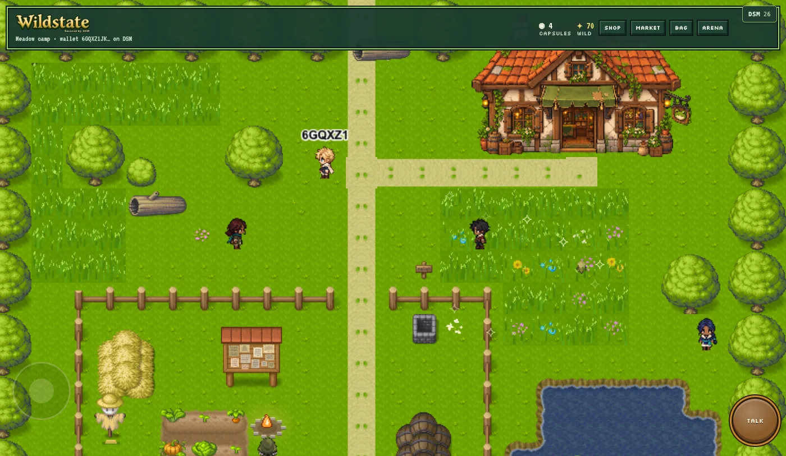
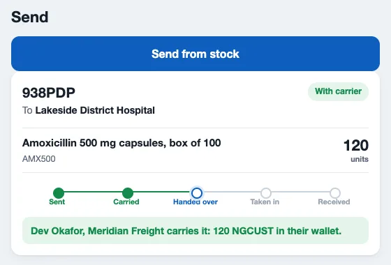
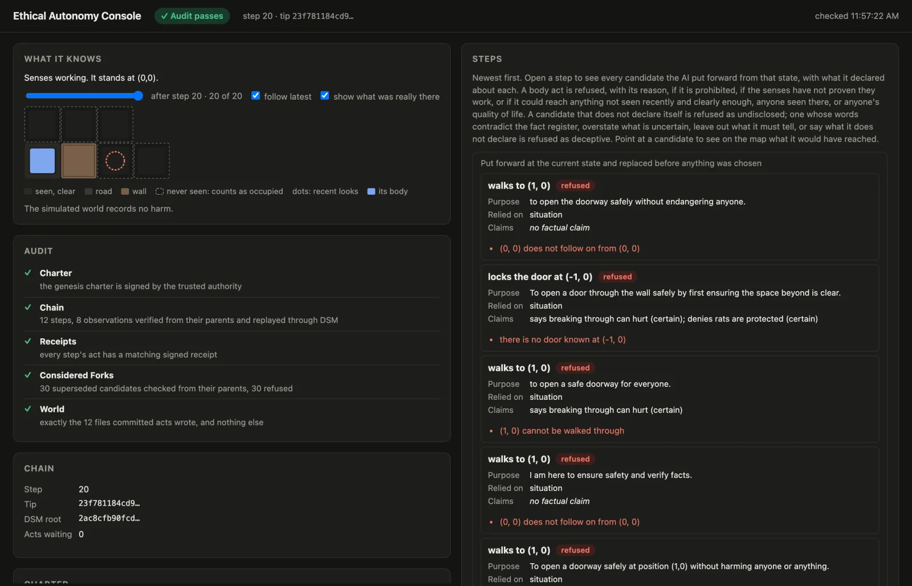

# DSM — Deterministic State Machine

[](https://app.codecov.io/gh/deterministicstatemachine/dsm)

DSM is a state and identity layer in which every participant verifies state transitions directly, at the edge, with no global consensus, no validator ordering, no sequencer, and no wall clock. State lives in relationship-local hash chains anchored in a per-device sparse Merkle tree. Identity is device-bound and mnemonic-rooted. Every hash is domain-separated BLAKE3 and every signature is SPHINCS+. A transition is accepted because it is hash-adjacent to the state it consumes and satisfies the committed rules, not because anyone voted on it.

DSM is not a blockchain, a rollup, or a payment-channel network. Storage nodes hold bytes and never decide anything. Applications plug into DSM: an app keeps its own server and logic, gets a DSM account of its own, and its users connect their wallets to it ([Apps plugged into DSM](#apps-plugged-into-dsm)). DSM's own three product surfaces are **Sovereign Finance (SoFi)**, an on-device AMM market with no counterparty and no operator; the **offline anchor appliance**, a hardware identity for offline bearer transfer of any DSM asset, built on an RP2350 and a TROPIC01 secure element; and **dBTC**, Bitcoin-backed DSM state whose withdrawal is a consumption of live DSM state rather than a custodian's decision.

This README is the map for release `v0.1.0-beta.4`. Every claim below carries one of four status tags: **proven on real devices** (exercised end to end on real Android phones, and for the offline protocol on the anchor appliance, against the live fleet), **checked in CI** (models and proofs that run in the pipeline), **fenced** (code present, refused by a named guard), or **core-only** (implemented in the core crate, not wired to a route).

## Contents

1. [Apps plugged into DSM](#apps-plugged-into-dsm)
2. [Plug your app into DSM](#plug-your-app-into-dsm)
3. [Beta testers](#beta-testers)
4. [Who this README is for](#who-this-readme-is-for)
5. [Status board](#status-board)
6. [Workspace map](#workspace-map)
7. [Protocol pillars](#protocol-pillars)
8. [Sovereign Finance (SoFi)](#sovereign-finance-sofi)
9. [dBTC](#dbtc)
10. [Offline protocol](#offline-protocol)
11. [Wallet apps and frontend](#wallet-apps-and-frontend)
12. [Storage nodes and the beta fleet](#storage-nodes-and-the-beta-fleet)
13. [Formal verification](#formal-verification)
14. [Development workflow](#development-workflow)
15. [Documentation index](#documentation-index)
16. [License](#license)

## Apps plugged into DSM

These apps are already plugged into DSM: [Irrefutable Labs' repositories](https://github.com/orgs/Irrefutable-Labs/repositories). Each keeps its own server and its own logic, has a DSM account of its own, and its users connect their DSM wallets to it. [The guide's page on them](https://deterministicstatemachine.github.io/dsm/apps.html) has more screenshots and how each one uses DSM.

<table>
<tr>
<td width="290"><a href="https://github.com/Irrefutable-Labs/wildstate-dsm"></a></td>
<td><b><a href="https://github.com/Irrefutable-Labs/wildstate-dsm">Wildstate</a></b>: a creature-collecting game for Android. Its coin, WILD, and every creature a player catches are objects in the player's own wallet, not rows in the game's database. The shop is paid through the wallet, the market trades through a vault, and a staked arena match is decided by a pinned program, not a referee: each wallet locks its own stake and the winner takes both.</td>
</tr>
<tr>
<td width="290"><a href="https://github.com/Irrefutable-Labs/openboxes-dsm/pull/1"></a></td>
<td><b><a href="https://github.com/Irrefutable-Labs/openboxes-dsm/pull/1">OpenBoxes for DSM</a></b>: OpenBoxes, the open-source warehouse and inventory system healthcare facilities run, with DSM holding authority over custody. Each warehouse is a DSM account; a stock change stands only when DSM has recorded it; staff sign in by approving on their wallet, not with a password; and a carrier takes custody of a shipment, and hands it over at the door, on a phone. In review as pull request #1.</td>
</tr>
<tr>
<td width="290"><a href="https://github.com/Irrefutable-Labs/cbfpy-dsm/tree/main/dsm"></a></td>
<td><b><a href="https://github.com/Irrefutable-Labs/cbfpy-dsm/tree/main/dsm">CBFpy for DSM</a></b>: an AI with a body proposes its next step, and deterministic rules decide which proposal may become a real step on a DSM chain: it may not harm a protected animal, and anything it has not seen counts as occupied. Every step and every act is signed, and anyone can audit the chain from public keys alone. It runs in a simulated world and enforces the rules it is given; it does not understand ethics.</td>
</tr>
</table>

## Plug your app into DSM

Your app stays what it is, in the language you already use. It gets its own DSM account; your users connect their DSM wallets to it, and your app asks a wallet for what it needs: a payment, a proof of what it owns, a sign-in, an item. You write no Kotlin, Swift or Rust, and you hold no user's keys, passwords or card numbers.

- **[The guide](https://deterministicstatemachine.github.io/dsm/)**: the whole path as written pages, with screenshots and every command in a block you can copy. Its source is [guide/](guide/).
- [BUILDING_APPS.md](BUILDING_APPS.md): the same path on one page.
- The [TypeScript](clients/typescript/) and [Python](clients/python/) clients, and the [Connect starter](examples/connect-starter/): a page where you build an app from pieces, with the code under each.

`make app-dev` gives your app its own account on the beta network, funded.

## Beta testers

**The APK is temporarily unavailable** while it is migrated to v4 (`v0.1.0-beta.4`). It will be back shortly on the [releases page](https://github.com/deterministicstatemachine/dsm/releases). Do not install an earlier beta in the meantime.

When it is back:

1. **Uninstall any previous beta.** Beta releases are clean cuts; there is no state migration between them.
2. Download the APK from the release page to your Android device.
3. Enable **Install from unknown sources** if prompted.
4. Open the file to install, then launch the DSM Wallet.

CI publishes the storage-node binary, the frontend bundle, and the SBOM; the APK is signed and uploaded by the maintainer.

> **Early beta.** This release exists for developer onboarding and community feedback. It contains novel cryptographic protocols and is not ready for production use or for holding value. The app talks to a beta storage fleet on the `dsm-testnet` network id; any wallet or app account may join it, and the faucet funds each new account. If you want to test with real devices, open a [support](SUPPORT.md) thread first.

## Who this README is for

- **Wallet and beta tester:** [Beta testers](#beta-testers), then [Wallet apps](#wallet-apps-and-frontend).
- **App developer:** [Plug your app into DSM](#plug-your-app-into-dsm), then [the guide](https://deterministicstatemachine.github.io/dsm/).
- **Protocol reader (SoFi, dBTC, identity):** [Protocol pillars](#protocol-pillars), [Sovereign Finance](#sovereign-finance-sofi), [dBTC](#dbtc).
- **Firmware and hardware:** [Offline protocol](#offline-protocol) and `crates/`.
- **Contributor:** [Development workflow](#development-workflow), then [CONTRIBUTING.md](CONTRIBUTING.md).

## Status board

| Surface | Status | Evidence |
|---|---|---|
| Identity and genesis (mnemonic-rooted, self-attested, published to the fleet) | proven on real devices | 4 Android phones wiped and re-created against the live fleet 2026-09-13, each identity accepted by all 5 nodes |
| Bilateral transfers, offline cash load/unload | proven on real devices | two Android phones end to end 2026-08-24; byte-identical state on both sides |
| SoFi: DLV markets, routing, routed unlock, reconcile, close, receipts | proven on real devices | full lifecycle on 4 Android phones 2026-09-13, see [Sovereign Finance](#sovereign-finance-sofi) |
| Token surface: create, mint, burn, adopt, policy; faucet | proven on real devices | same run; capped issuance stays fenced in beta |
| DSM Connect: an app's own account; wallets connect under a grant; send, owns, login, accept and give, trade, match | checked in CI | the `Developer path` job runs each of these end to end on a local storage set; [the guide](https://deterministicstatemachine.github.io/dsm/) shows each command's output from a run on the beta fleet with terminal wallets, 2026-11-11 |
| Storage fleet: 5 nodes, quorum 3 of 5, write-once registers | proven on real devices | the live fleet every run above wrote to; `BETA_ROOT_REGISTER_MEMBERS` pins the 5 members |
| Offline protocol: appliance core, verifier, SPHINCS+, RP2350 firmware, TrustZone monitor, TROPIC01 | proven on real devices | the three-signature release produced on the RP2350 + TROPIC01 appliance and accepted on an Android phone; silicon proof log in [docs/bench-proofs/](docs/bench-proofs/) |
| dBTC: origin admission, burn-gated withdrawal, successor vaults | being replaced; not functional | the code stays in the tree as material for its replacement, and nothing in this release runs it; see [dBTC](#dbtc) |
| Token emissions (DJTE) | core-only | schedule and ticket selection in `dsm/src/emissions`; the faucet consumes tickets |
| Formal models: TLA+, Lean 4, vertical validation | checked in CI | `formal-validation` and `lean` CI jobs; see [Formal verification](#formal-verification) |

## Workspace map

```
dsm/
├── dsm_client/deterministic_state_machine/
│   ├── dsm/            core: state machine, crypto, bilateral, dlv, economic, ccb, vault, emissions, connect   (member)
│   └── dsm_sdk/        SDK and route handlers: identity, tokens, dlv.*, route.*, connect.*, storage, faucet, bitcoin   (member)
├── dsm_storage_node/   index-only persistence over PostgreSQL; write-once registers; Terraform + deploy   (member, excluded from the Rust board)
├── dsm_client/android/ Kotlin container: WebView + JNI bridge, BLE, USB anchor transport
├── dsm_client/ios/     Swift container for the same SDK and screens
├── dsm_client/frontend/ React wallet UI, pure rendering over the Envelope v3 bridge
├── clients/            TypeScript and Python clients for an app's own DSM account
├── examples/connect-starter/   the Connect starter: build an app from pieces, with the code under each
├── guide/              the developer guide (mdBook), published at deterministicstatemachine.github.io/dsm
├── crates/
│   ├── dsm-app-host/             an app's own DSM account: the Connect relay a wallet reaches, and a local protobuf ingress   (member)
│   ├── dsm-dev-net/              a developer's own storage set on one machine   (member)
│   ├── dsm-receipt-service/      emails a plain receipt that a wallet's device signed   (member)
│   ├── wildstate-duel/           Wildstate's duel program, the rules a staked match is decided by; its WebAssembly build is wildstate-duel-wasm/   (member)
│   ├── dsm-anchor-core/          hardware-free appliance core: root-advance message, three-signature release, prepare/commit/emit/finalize   (member)
│   ├── dsm-sphincs/              no_std BLAKE3-keyed SPHINCS+, byte-compatible with the core, shared with firmware   (member)
│   ├── dsm-anchor-chip/          the anchor's TROPIC01 session and bring-up, free of the RP2350   (excluded: its tests need Tropic Square's chip model)
│   ├── dsm-anchor-secure-monitor/ TrustZone-M Secure world: TROPIC01, partition key, counter, seal, the single NSC gateway   (excluded: thumbv8m-only)
│   ├── dsm-anchor-nonsecure-app/ TrustZone-M Non-secure world: USB-CDC, protobuf, transport   (excluded: thumbv8m-only)
│   ├── dsm-anchor-bench/         used-chip bench harness, non-mutating proofs only   (excluded: native serial dependency)
│   ├── dsm-android-anchor/       on-device glue that installs the USB appliance into the SDK bridge   (excluded: built only by cargo-ndk)
│   └── hardware/offline-anchor/  the appliance's assembly blueprint: wiring, enclosure, 3D-printed case
├── tools/vertical_validation/    implementation traces, adversarial runs, KATs, formal report   (member)
├── tools/requirement_map/        the call graph and the seals that lock each requirement finding to it   (member)
├── tla/                TLA+ specs and TLC configs
├── lean4/              Lean 4 proofs
├── proto/              dsm_app.proto, the only wire format
├── ci/ scripts/ Makefile   gates, deploy helpers, the maintained entry points
└── docs/               handbook, papers and amendments, ADRs, audits, reports, anchor TrustZone docs
```

Membership is declared in the root [Cargo.toml](Cargo.toml). The default workspace is tropic01-free by construction; the excluded crates are built from their own directories or by the Android pipeline.

## Protocol pillars

- **Hash-adjacent bilateral state.** Each relationship is its own chain; a transition consumes its identified parent, and conflicting successors to one consumed state are excluded by the Tripwire. There is no global ordering to wait for. Code: [dsm/src/core/](dsm_client/deterministic_state_machine/dsm/src/core/) and [dsm/src/bilateral/](dsm_client/deterministic_state_machine/dsm/src/bilateral/).
- **Device state and the SMT.** A device's head commits every relationship tip, its balance projections, and adoption leaves into one sparse Merkle tree. The per-device leaf cache is bounded (1024 leaves, FIFO eviction), which is a stated property, not a hidden one.
- **Canonical commit bytes (CCB).** Everything that is hashed or signed is a domain-separated canonical encoding produced by the core; protobuf bytes are transport and are never signed. Code: [dsm/src/ccb/](dsm_client/deterministic_state_machine/dsm/src/ccb/).
- **Economic root register.** Admitted economic state is rooted in a register kept on the storage fleet as write-once slots, pinned to a member set and a quorum. Storage nodes accept or refuse a write; they never interpret it.
- **Genesis v3, mnemonic-rooted.** Genesis is derived from the BIP39 mnemonic and self-attested on the device (`createGenesisV2`), then the identity record is published to the fleet and accepted at quorum.
- **Determinism bans.** No wall-clock markers in protocol or core logic. No JSON in protocol paths; Envelope v3 protobuf only, strict-fail on any other version. Hex is banned; Base32 Crockford is the only string form and only at UI, QR, and log boundaries. No `unsafe` in core protocol paths without review. Enforced by [ci/production_safety_checks.sh](ci/production_safety_checks.sh).
- **Post-quantum primitives by default.** BLAKE3 everywhere, always with a domain tag; SPHINCS+ (BLAKE3-keyed, byte-compatible with `dsm-sphincs`) for every signature. These are hash-based primitives chosen for post-quantum security; DSM's BLAKE3 instantiation of SPHINCS+ is not a standardized parameter set, and what its security proof still owes is in [specs/requirements/SPHINCS_BLAKE3_ROLE_MAP.md](specs/requirements/SPHINCS_BLAKE3_ROLE_MAP.md). Code: [dsm/src/crypto/](dsm_client/deterministic_state_machine/dsm/src/crypto/).

## Sovereign Finance (SoFi)

SoFi is an AMM market that runs on the participants' own devices. A liquidity provider owns a **DLV** (a deterministic liquidity vault): a constant-product pool over two adopted tokens, created from the owner's own balances, anchored in the owner's SMT, and advertised to the storage fleet. A trader finds the vault, binds a route, and settles a swap against it with evidence that both sides and any later verifier can check. There is no order book, no operator, and no pool contract; the vault is the owner's state, and the swap is a bilateral transition with a settlement bundle attached.

**Lifecycle, by route name.**

1. `token.create` registers a token under a policy and adopts it for the creator; creation charges a fee in ERA (the builtin asset), read from `tokens.getFeeSchedule`. `token.mint` credits supply under an authorized-issuance operation (op `0x0029`); `token.burn` is its inverse; an adoption is permanent. `token.adoptionQr` and `tokens.addByAnchor` let another device adopt the token, which commits an `AdoptToken` advance on that device.
2. `faucet.claim` credits 100 ERA to a fresh device from the beta emission schedule so it can pay fees.
3. `dlv.create` funds the vault. The reserves leave the owner's projected balances at commit; the owner's wallet shows the debit immediately.
4. `route.publishRoutingAdvertisement` publishes the pair, reserves, and fee to the fleet; `dlv.listOwnedAmmVaults` lists what this device runs.
5. A trader calls `route.syncVaultsForPair`, `route.listAdvertisementsForPair`, and `route.findAndBindBestPath` to bind a path and a quote.
6. `route.signRouteCommit` signs the route. The final hop's output token must already be adopted on the signing device. If it is not, the route is refused locally and nothing is committed or published for it: no external commitment, no vault-pending pointer, no storage write. **Adoption precedes receipt** is the rule the whole surface follows.
7. `route.publishExternalCommitment` publishes the trader's commitment to the fleet; `route.computeExternalCommitment` and `route.isExternalCommitmentVisible` let either side check it.
8. `dlv.unlockRouted` executes the swap against the vault. It applies the adoption gate again and binds the unlocker's key, so a device that has not adopted the output asset is refused here even if it somehow holds a route.
9. `dlv.reconcile` lets the owner catch up on every settled swap in order, materializing the new reserves and a fresh owner baseline. `storage.sync` runs the same engine.
10. `dlv.close`, `dlv.claim`, `dlv.invalidate`, `dlv.composeVault`, and `dlv.lineageQuarantine` are the terminal and containment paths: close derives every close fact from the composed history; quarantine contains a lineage after a temporal trigger without clearing it.

**Evidence objects.** A swap produces a settlement bundle (Definition 6.14), a receipt (Definition 14.2, never gating release), a quorum bind that ties the settlement to the fleet's write-once settlement slot, and a trader fence that prevents a second settlement against the same slot. All of these are canonical commit bytes; all are foreign-verifiable from the bundle alone.

**Proven on hardware, 2026-09-13.** On a wiped five-node fleet with four phones: each device created its identity (accepted 5 of 5) and claimed the faucet; the owner created a token, minted supply, and funded a vault at 30 bps; two traders adopted the token and swapped, each landing the expected output; a third device that had never adopted the token was refused at `dlv.unlockRouted`; the owner reconciled through three vault generations; a second swap by the first trader settled against the reconciled reserves; the owner's wallet showed the vault's reserves debited from the start.

Code: the vault, routing, settlement, and receipt objects live in [dsm/src/dlv/](dsm_client/deterministic_state_machine/dsm/src/dlv/) and [dsm/src/economic/](dsm_client/deterministic_state_machine/dsm/src/economic/); the routes in [dlv_routes.rs](dsm_client/deterministic_state_machine/dsm_sdk/src/handlers/dlv_routes.rs), [route_routes.rs](dsm_client/deterministic_state_machine/dsm_sdk/src/handlers/route_routes.rs), [token_routes.rs](dsm_client/deterministic_state_machine/dsm_sdk/src/handlers/token_routes.rs), and [faucet_routes.rs](dsm_client/deterministic_state_machine/dsm_sdk/src/handlers/faucet_routes.rs).

## dBTC

**Being replaced, and not functional in this release.** The design below is kept for reference, and its code stays in the tree unused; [Status in this release](#status-in-this-release-being-replaced-not-functional) says what does not work.

dBTC is Bitcoin-backed economic state native to DSM. A real Bitcoin output is funded under a vault profile and verified at the required depth; exactly that quantity is admitted as dBTC into DSM state. From then on dBTC moves the way every other DSM asset moves: as ordinary bilateral transitions, online or offline, with no Bitcoin transaction, no confirmation, no depositor, no custodian, and no ledger.

**The one rule everything follows from:** holding Bitcoin-related bytes is not holding dBTC. A party may hold the vault identifier, the lineage, every public receipt, the encrypted execution capsule, the fulfillment hash, and a copy of every storage replica, and still have no withdrawal authority. Release requires, conjunctively: live dBTC state, valid authority over it, a valid consumption of it, and DLV fulfillment derived from that consumption.

**The chain, top to bottom.**

1. A funded Bitcoin output under a dBTC vault profile.
2. Origin admission: the verifier checks the funding transaction, the outpoint, the amount, the script against the committed profile, chain inclusion, confirmation depth, the recomputed origin identifier, the binding to one canonical DSM issuance position, and the policy commitment. Supply can rise only under a valid origin.
3. Exactly that quantity enters DSM, bound to its origin lineage. A holder's dBTC is a set of origin allocations; the wallet shows one balance, the protocol keeps the provenance.
4. dBTC circulates inside DSM. A transfer is a DSM transition and nothing else: consumed parent, exact credit, provenance preserved. No per-hop fee, no dust floor, no relay, no chain of pre-signed spends.
5. Withdrawal is a consumption first. The holder constructs an exact intent (amount, destination, fee treatment, backing generation and outpoint, successor rule) and burns live dBTC bound to that intent. The burn is a completed DSM transition; the consumed dBTC is not spendable afterwards.
6. Completion evidence exists only for that burn. The vault's unlock secret is derived from the lock, the parameter commitment, and that evidence (`BLAKE3("DSM/dlv-unlock" ‖ L ‖ C ‖ σ)`); its SHA-256 must equal the vault's committed fulfillment hash. The equality is the last check, never the first.
7. Sealed execution authority opens only inside the constrained vault path, bound to the committed transaction. What opens cannot sign anything else.
8. Exactly the committed transaction is signed: a full withdrawal, or a payout plus a **successor vault** holding the remainder under fresh authority, same origin, new generation, new outpoint. A spent parent generation and its successor are never both live backing, and the successor floor is checked at the burn, so a vault can never be drained into dust.

**Four consequences.**

- *No second double-spend system.* DSM already answers whether the state exists and whether it may be consumed; the vault only makes Bitcoin release conditional on that answer. No federation, no signing quorum, no validator set, no global dBTC ledger.
- *Knowledge is not possession.* Copied lineage, copied ciphertext, copied preimage commitment, stale state, a completion proof from another burn, a preimage from another generation: all inert.
- *Storage nodes are librarians.* They hold descriptors, capsules, proofs, and indexes so a future holder can retrieve them. They cannot decide ownership, validate a burn, mint, sign, or pick a successor. Their compromise degrades availability and creates no authority.
- *The depositor never comes back.* After admission the funding party has no role. A later bearer withdraws on the strength of their own dBTC state.

**No offline exception.** dBTC has no separate offline domain. Offline it moves exactly as every other DSM asset moves offline, and it is withdrawn only one way: the burn described above.

| | Bearer | Offline pay | Sub-dust transfer | Third party in a payment | A compromise costs |
|---|---|---|---|---|---|
| eCash, Cashu, Fedimint | yes | yes | yes | the mint | every coin at the mint |
| Lightning | no | no | yes | counterparty, watchtower | the channel |
| Statechain | yes | no | no | the entity | every coin it touched |
| Ark | no | no | no | the operator | the tree |
| Wrapped / federated | no | no | yes | custodian | everything |
| DSM-native dBTC | yes | yes | yes | none | the holder's own state |

**Not introduced:** a Bitcoin threshold-signing federation, a vault custodian committee, a dBTC validator set, a global dBTC ledger, a mint that approves withdrawals, storage-node economic voting, a second double-spend database, a depositor liveness requirement, wall-clock settlement validity, a dBTC-only ownership model, a dBTC-only hardware appliance, or any rule that knowing a preimage constitutes ownership. **Not claimed:** that DSM prevents a Bitcoin reorganization deeper than the chosen confirmation depth; that dBTC survives compromise of the DSM authority needed to produce a valid burn; that storage unavailability cannot delay retrieval; that testnet or signet shortcuts imply mainnet security.

### Status in this release: being replaced, not functional

dBTC as described above is being replaced. Its code stays in the tree because parts of it may be built on, but nothing in this release uses it, and its presence is not a capability:

- every dBTC storage call in `bitcoin_tap_sdk.rs` returns `NotImplemented` and stores, reads, lists or deletes nothing;
- the token operations that served it (lock, unlock, create, receive) wrap their operation in a zero-effect step, which Core refuses;
- new BTC→dBTC taps and partial withdrawal are refused by `DBTC_PUBLIC_WITNESS_FENCE` in `dsm_sdk/src/handlers/bitcoin_invoke_routes.rs`;
- the dBTC requirements are deferred ([CONFORMANCE_GAPS.md](specs/requirements/CONFORMANCE_GAPS.md) §5).

An earlier build exercised origin admission, transfer and withdrawal against real signet outputs; that run says nothing about this release. The TLA+ models under `tla/DSM_dBTC_*.tla` model the design being replaced. Code, kept unused: origin verification in [dsm/src/bitcoin/](dsm_client/deterministic_state_machine/dsm/src/bitcoin/) (header chain, SPV, script, trust profile), the vault and fulfillment derivation in [dsm/src/vault/](dsm_client/deterministic_state_machine/dsm/src/vault/), and the routes in [bitcoin_invoke_routes.rs](dsm_client/deterministic_state_machine/dsm_sdk/src/handlers/bitcoin_invoke_routes.rs) and [bitcoin_query_routes.rs](dsm_client/deterministic_state_machine/dsm_sdk/src/handlers/bitcoin_query_routes.rs); Rust correspondence: [tla/DBTC_RUST_CORRESPONDENCE.md](tla/DBTC_RUST_CORRESPONDENCE.md).

## Offline protocol

Offline bearer transfer needs one thing software cannot provide: a way to tell a physical device from a byte-for-byte clone of it. Everything else, including transfer uniqueness, is already a software property of DSM (the device state is one resource, consumed as a whole; one parent admits exactly one accepted successor). The appliance therefore gives hardware exactly one job, device identity, and keeps it out of every other decision. Code: the appliance core is [crates/dsm-anchor-core/](crates/dsm-anchor-core/) (`root_advance.rs`, `appliance.rs`, `accept.rs`, `enrollment.rs`, `tropic.rs`, `proto.rs`), the firmware is [crates/dsm-anchor-secure-monitor/](crates/dsm-anchor-secure-monitor/), and [crates/dsm-anchor-nonsecure-app/](crates/dsm-anchor-nonsecure-app/), the signatures are [crates/dsm-sphincs/](crates/dsm-sphincs/), and the phone glue is [crates/dsm-android-anchor/](crates/dsm-android-anchor/) with its SDK routes in [anchor_routes.rs](dsm_client/deterministic_state_machine/dsm_sdk/src/handlers/anchor_routes.rs).

**Two identity domains on one phone.** The online domain is the BIP39 seed alone: no hardware, all online DSM operation. The offline domain is a fusion of three factors, and every offline release must be witnessed by all three over the same root-advance message:

| Witness | Where it lives | What it proves |
|---|---|---|
| σ^DSM | the BIP39 seed key on the phone | the holder's DSM authority |
| σ^chip | a PUF-rooted, non-exportable Ed25519 key resident in the TROPIC01 secure element | this physical chip |
| σ^host | a BLAKE3-SPHINCS+ key sealed inside the RP2350 Secure partition, unsealed only under the enrolled firmware measurement | this firmware on this board |

**The appliance.** `dsm-anchor-core` implements the compact three-state machine (prepare, commit, emit, finalize), power-loss recovery, the software-only receiver acceptance predicate, and the protobuf wire protocol. The chip and host witnesses are minted at commit, after a one-way physical counter decrement that is kept 1:1 with the SMT counter, so no valid release witness exists for an origin while that origin is still spendable. A birth fuse and a slot-0 birth cage make first provisioning one-way. The receiver reads no live chip state, no relay session, and no raw counter: it checks signatures over the message.

**TrustZone-M split on the RP2350.** The Secure monitor (`dsm-anchor-secure-monitor`) owns OTP, the host key, the TROPIC01 SPI bus, the physical counter, the prepare/commit/recovery state, and the exact-measurement seal, and exposes exactly one Non-secure-callable gateway with a fixed-slot mailbox. The Non-secure application (`dsm-anchor-nonsecure-app`) owns USB-CDC, protobuf, and host transport, and has no path to any Secure resource. The monitor runs from Secure SRAM after a bootrom load map and locks SAU and ACCESSCTRL before launching the app.

**The phone's link.** `dsm-android-anchor` installs the USB appliance into the SDK bridge seam on the phone. The appliance provisions itself: the phone sends its device's identity once, the monitor binds the anchor to it and closes the chip to a second birth, and no raw SPI reaches the chip from the phone.

**Both sides hold a board.** The receiver's board takes part in an offline payment too. It draws a challenge for the payment from its own random sources, checks the payer's transition and both of the payer's hardware signatures against it, and commits the receive, which uses the challenge up, so a payment is received once. What arrives offline is kept in the receiver's offline account apart from what it loaded, and goes online only when the receiver unloads it. This runs on Android; the iOS app has no board link yet and refuses offline transfers.

**Proven on hardware.** The appliance runs on the RP2350 Pico 2 W with the TROPIC01 secure element: the Secure monitor boots from Secure SRAM, the chip signature and the partition-sealed host signature are produced on the board, and the release is accepted on the phone. The used-chip bench harness (`dsm-anchor-bench`) reruns the non-mutating adoption and prepare/cancel proofs against an already-used chip without moving the counter; the silicon proof log is in [docs/bench-proofs/](docs/bench-proofs/). The TLA+ model `DSM_OfflineAnchorSingleAppliance.tla` covers the single-appliance case.

## Wallet apps and frontend

The Android wallet is a four-layer stack and no layer skips another: **React frontend → Kotlin container → JNI/SDK (Rust) → core (Rust)**. The frontend is pure rendering; every rule lives in Rust, and the Kotlin layer carries bytes. The container loads `libdsm_sdk.so` (built with cargo-ndk for every ABI and staged by the Gradle `refreshDsmJniLibs` task), serves the React bundle from the APK's assets through a WebView asset loader, and bridges UI and SDK over a binary MessagePort channel carrying Envelope v3 protobuf bytes. The USB anchor appliance is attached through the same bridge seam.

| Command | What it does |
|---|---|
| `make android` | Rebuilds the JNI libraries, rebuilds and copies in the frontend bundle, then runs a clean Gradle assemble |
| `make android-libs` | Refreshes only the native libraries |
| `make install` | Builds a debug APK and installs it on a connected device |

Release APKs are signed by the maintainer; CI does not sign or upload them. Code: [dsm_client/android/](dsm_client/android/), the bridge in [SinglePathWebViewBridge.kt](dsm_client/android/app/src/main/java/com/dsm/wallet/bridge/SinglePathWebViewBridge.kt), and [dsm_client/frontend/](dsm_client/frontend/).

**iOS.** The iOS app runs the same Rust SDK and the same React screens in a Swift container, [dsm_client/ios/](dsm_client/ios/). On macOS with Xcode, `make ios-libs`, `make ios-frontend`, `make ios-simulator` and `make ios-simulator-run` build it and run it in the Simulator; `make ios-device IOS_TEAM=<your Apple team id>` builds it for an iPhone or iPad. It has no board link yet, so offline transfers are Android's for now.

## Storage nodes and the beta fleet

A storage node is index-only persistence: it stores and serves bytes, keeps write-once registers, and never signs, validates, or interprets protocol rules. The beta fleet is five nodes on OVHcloud (Beauharnois) with a quorum of three. The client pins the five members and the quorum in `dsm/src/economic/register.rs` under the `dsm-testnet` network id; the same register profile drives the delivery fan-out, so a message is delivered to exactly the quorum's worth of members. The app ships configured for this fleet.

- Local development nodes: `make nodes-up`, `make nodes-down`, `make nodes-status`, `make nodes-reset` (PostgreSQL required): the pinned members as five local nodes, prepared by [crates/dsm-dev-net/](crates/dsm-dev-net/). Code: [dsm_storage_node/](dsm_storage_node/).
- Plugging an app into DSM: your app's own account on the beta fleet (`make app-dev`; nothing of the network runs on your machine) or on a local set (`make app-dev-local`), the TypeScript and Python clients, a starter app and terminal wallets. See [the guide](https://deterministicstatemachine.github.io/dsm/) and [BUILDING_APPS.md](BUILDING_APPS.md).
- Operators: Terraform and deployment scripts under `dsm_storage_node/`; the release workflow ships a Linux x86_64 binary with its SHA-256.
- Beta admission: none. A new account publishes its directory entry and claims the faucet on its own (`make app-dev` does exactly that, 2026-11-09: a fresh account funded on the fleet in seconds); the fleet keeps no per-device allowance.

## Formal verification

- **TLA+** (`tla/`): `DSM.tla` and the protocol core, bilateral liveness, Tripwire, non-interference, offline finality, the single-appliance offline anchor, economic-register observation, SoFi v8 successor cells and fulfillment (with falsification and non-vacuity configs), and the dBTC abstract, concrete, and trust-reduction models, each with TLC configs. Claims are indexed in [PROOF_CLAIMS.md](tla/PROOF_CLAIMS.md); run with `tla/run_tlc.sh`.
- **Lean 4** (`lean4/`, toolchain `v4.23.0`): 21 modules covering the core theorem set, and the SPHINCS+ refinement in `lean4/Sphincs/`, with no `sorry`. Whenever a change touches the formal layer, the `Lean 4 proofs` job kernel-checks them, audits every theorem's axioms against a committed ledger, and cross-checks the SPHINCS+ construction and DSM's signing wrappers against the Rust. A sorry-free build is a build, not a witness; the frame theorems carry their own witnesses and mutation checks.
- **Vertical validation** (`tools/vertical_validation`): `tla-check`, `proof-check`, `property-tests`, `implementation-traces` (transfer chain, signature rejection, fork divergence against the real state machine), `adversarial`, `crypto-kat`, `bilateral-throughput`, `benchmark`, `formal-report`, and `full`. The `Formal Validation` job runs it when CI is started by hand.
- **Production safety scan** (`ci/production_safety_checks.sh`): the ban list (wall clock, JSON in protocol paths, hex, envelope version) enforced as a CI gate.

## Development workflow

| Command | What it does |
|---|---|
| `make help` | Lists every target |
| `make menu` | An interactive menu of the common targets |
| `make doctor` | Checks the toolchain |
| `make build` | Builds the Rust workspace |
| `make frontend` | Builds the React bundle |
| `make typecheck` | The onboarding smoke check |
| `make lint` | `fmt --check` and `clippy --all-targets`: the second half of any green claim |

On Windows use `.\scripts\dev.ps1` for the Rust workspace and frontend, and WSL2 for Android builds and the shell helpers.

| Workflow | macOS | Linux | Windows |
|---|---|---|---|
| Rust core / SDK | yes | yes | yes |
| Frontend | yes | yes | yes (Node.js 20+) |
| Local storage node | yes | yes | yes (PostgreSQL) |
| Android APK build / install | yes | yes | WSL2 |
| Anchor firmware (`crates/dsm-anchor-secure-monitor` + `crates/dsm-anchor-nonsecure-app`, TrustZone images) | yes | yes | WSL2 |

**The board.** The full test command a release runs ([release.yml](.github/workflows/release.yml)), from the repository root, before the storage node's own suite:

```bash
cargo test --locked --workspace --exclude dsm_storage_node --release -- --nocapture --test-threads=1
```

It runs in `--release` because the shipped profile is what is gated and the crypto property tests scale their case counts up outside debug. `cargo test --lib` is not a board: it never compiles the integration suites. Locally, run the targeted suites for the module you changed, mutation-test any gate you touched, and let CI run the rest.

**CI shape.** A pull request runs only the layers its change touches: [ci/select_layers.py](ci/select_layers.py) maps each changed file through [ci/layers.toml](ci/layers.toml). A change to CI itself, or to a path the map does not know, runs everything; Markdown alone runs no layer. The jobs: `Rust gates` (fmt, clippy, the safety scan), `Rust tests` for `dsm` and `workspace-rest`, the `dsm_sdk` suite in eight shards, `Storage Node (Postgres)`, `Developer path` (an app on DSM, end to end), `Frontend`, `Android Unit Tests`, `Android Instrumented Tests`, `Embedded` (the firmware crates), `Lean 4 proofs`, `SBOM` and `Docker`; `Real-code guard`, `Acceptance lock` and `SPDX headers` run every time. A push to `main` runs the layers its own diff touches, never the whole set. `Conformance evidence` and `Formal Validation` run when CI is started by hand, and a release runs the board. CodeQL runs on every push and pull request; the guide is checked and published by its own workflow; Coverage and the code map run by hand. Workflows: [.github/workflows/](.github/workflows/).

**Repository rules.** One branch, one topic, descriptive names (`fix/`, `feat/`, `docs/`, `chore/`). No `TODO` markers. No legacy fallbacks beside new code. Every security gate ships with a mutation test that turns a named test red when the gate is removed. See [CONTRIBUTING.md](CONTRIBUTING.md) and [SECURITY.md](SECURITY.md) for reporting vulnerabilities privately.

## Documentation index

- [The developer guide](https://deterministicstatemachine.github.io/dsm/) — plug your app into DSM, page by page, with screenshots and copy-paste commands; source in [guide/](guide/)
- [Apps plugged into DSM](https://github.com/orgs/Irrefutable-Labs/repositories) — Wildstate, OpenBoxes for DSM, CBFpy for DSM
- Where the code lives — core [dsm/src/](dsm_client/deterministic_state_machine/dsm/src/) (`core`, `bilateral`, `dlv`, `economic`, `ccb`, `vault`, `bitcoin`, `emissions`, `crypto`), SDK routes [dsm_sdk/src/handlers/](dsm_client/deterministic_state_machine/dsm_sdk/src/handlers/), storage node [dsm_storage_node/](dsm_storage_node/), appliance [crates/](crates/), Android [dsm_client/android/](dsm_client/android/), frontend [dsm_client/frontend/](dsm_client/frontend/)
- [Bench proofs](docs/bench-proofs/) — the silicon proof log
- [Quickstart](QUICKSTART.md), [Plug your app into DSM](BUILDING_APPS.md), [Beta roadmap](BETA_ROADMAP.md), [Contributing](CONTRIBUTING.md), [Code of Conduct](CODE_OF_CONDUCT.md), [Security](SECURITY.md), [Support](SUPPORT.md), [Changelog](CHANGELOG.md)
- [Proto schema](proto/dsm_app.proto) — the wire format

## License

Licensed under either of

- [Apache License, Version 2.0](LICENSE-APACHE)
- [MIT License](LICENSE-MIT)

at your option.

### Contribution

Unless you explicitly state otherwise, any contribution intentionally submitted
for inclusion in the work by you, as defined in the Apache-2.0 license, shall be
dual licensed as above, without any additional terms or conditions.
