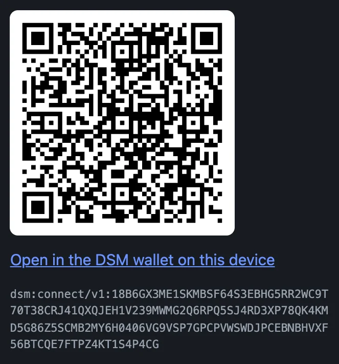
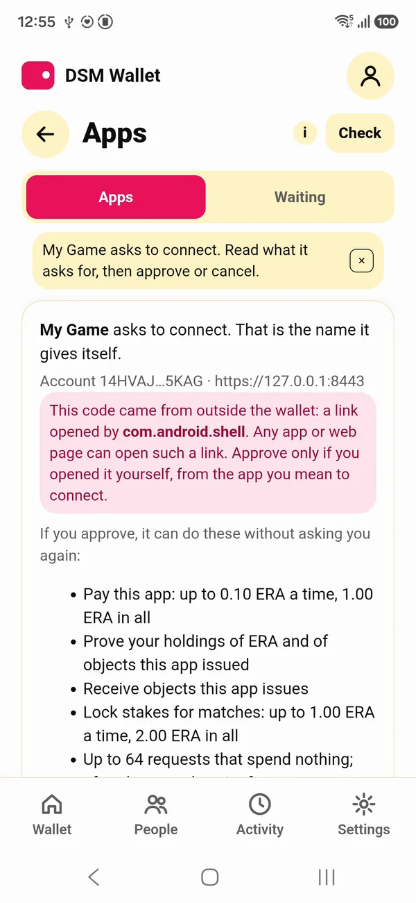
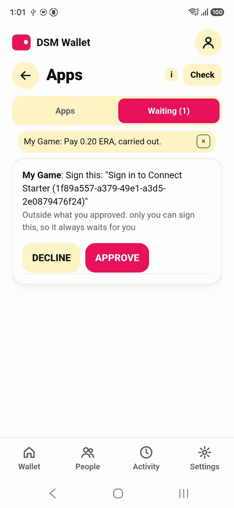
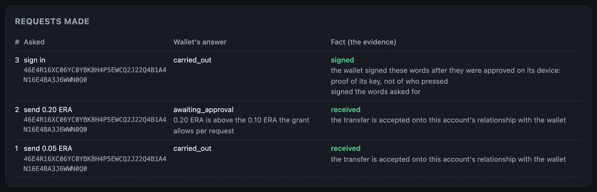

<div class="dsm-hero"></div>

# Plug your app into DSM

Your app stays what it is: a game, a shop, a service, in the language you already use. You don't build on DSM the way you build on a blockchain, with contracts and a new language. You plug in. Your app gets **its own DSM account**, your users connect **their DSM wallet** to it, and from then on your app can ask the wallet for things. Your own account tells you, with evidence, what happened.

- You write no Kotlin, Swift or Rust. The wallet exists, on Android and iOS.
- You hold no user's keys, passwords or card numbers.
- You learn a dozen words: `offer`, `connections`, `request`, `result`; `send`, `owns`, `accept`, `trade`, `match`, `login`; `issue`, `give`.

This guide walks the whole path, a page at a time. Every command on these pages is in a box with a copy button; paste it into a terminal as it is. The screenshots are from real runs.

1. [Set up your machine](setup.md): the tools, the code, a check.
2. [The wallet on Android and iOS](wallet.md): what your players run. Optional; a wallet in the terminal does for testing.
3. [Your app's own DSM account](account.md): one command, and your app has an account on the beta network, funded.
4. [Make an offer, connect a wallet](connect.md): a code, a scan, an approval.
5. [Ask the wallet for things](requests.md): a payment, a proof of what it owns, a sign-in, an item.
6. [Write it into your app](clients.md): the same calls in TypeScript and in Python.

Then, when you want them: [shops, matches and contacts](advanced.md), [running your app's account in production](production.md), and [a storage set of your own](own-storage-set.md).

## Where this takes you

By the fifth page your app has shown a code, a wallet has connected to it, and your app has asked it for things:

<div class="shots">
<figure style="flex-basis:250px;max-width:250px"><figcaption>Your app shows a code.</figcaption></figure>
<figure><figcaption>The player sees what it asks for, and approves.</figcaption></figure>
<figure><figcaption>A sign-in, approved on the phone.</figcaption></figure>
</div>

<figure class="term"><a href="images/starter-requests.webp"></a><figcaption>And your own account established the facts: two payments received, one sign-in signed.</figcaption></figure>

Each page ends with all of its commands as one script, and [Write it into your app](clients.md) has the whole app as one program, in JavaScript and in Python, to copy and run.

Apps already plugged into DSM, a game, a warehouse system and a prototype AI with a body, are on [Apps plugged into DSM](apps.md), with screenshots of each.

## What DSM is, for an app builder

- Each party keeps its own state. Your app has an account, each player has a wallet.
- There is no global ledger to wait on, no validators and no fee market. Storage nodes keep an index of where everyone's state is, and decide nothing.
- You plug in. You deploy nothing anywhere.

## Your app is an account

Your web app stays a web app. Beside it runs one process, the app host, and that process is your DSM account: one real identity, running the same code a phone runs. Your server talks to it on the same machine. Wallets reach it over TLS, through what it calls its relay.

```text
 your app's server ──HTTP+protobuf (loopback, secret)──► dsm-app-host ──► storage nodes
                                                          (your app's      (the network's
                                                           DSM account)     storage set)
                                                               ▲
 player's DSM wallet (phone) ──HTTPS, pinned in the code──────┘  (the relay)
```

The relay carries messages and proves nothing. What counts is what your account itself establishes from the evidence: a transfer it accepted, a proof it verified, a signature it checked.

## Connect, in one picture

<div class="flow"><span>offer</span><i>→</i><span>code</span><i>→</i><span>scan</span><i>→</i><span class="here">grant</span><i>→</i><span>requests</span><i>→</i><span>answers</span></div>

Your app makes an **offer**: its name, and what it wants to be allowed to do. The offer becomes a **code**. A wallet scans it, shows the player what is asked, and the player approves a **grant**. From then on your app sends **requests**, and the wallet answers: at once when a request is inside the grant, and after the player says so when it is not.

A grant is the player's consent, written down: which kinds of requests your app may make without asking again, and the caps on each, per request and in all. It is not a validity rule. Every request still runs through the same routes the player would use by hand, so a grant never lets your app do something the player could not do themselves.

## What your app can never do

- **Hold the player's keys.** They never leave the phone.
- **Spend past a cap.** The wallet refuses, and asks the player.
- **Treat anything the relay says as proof.** The only facts are the ones your own account established.

## What you can replace

| You run today | With DSM | Why it's better |
|---|---|---|
| Passwords, password resets, an authenticator app, SMS codes, security keys | `ask.login`: the player approves "Sign in to *your app*" on their device, and the wallet's identity signs it. Your account verifies the signature and gives you the fact `signed`. | Nothing to store but a nonce, nothing to leak, nothing to phish: the words are shown on the device and signed there. Post-quantum signatures. No hardware key to buy, ship or replace. |
| A payment processor for in-app purchases | `ask.send`: the wallet sends your account ERA, or a coin you issued. Fact: `received`. | A transfer your account accepted is final; there is no chargeback. Small amounts cost what a storage write costs, not a percentage plus a fixed fee. Inside the grant's caps the player is not asked again. |
| An inventory database as the source of truth for who owns what | `issue` an object, `give` it, and later `ask.owns`: the wallet proves what it owns, and your account verifies the proof. Fact: `owns`. | Items are the player's: they can send them to each other in the wallet, and your app still sees who holds what. Your database keeps game state; ownership lives with the player. |
| An escrow service, or trusting yourself with both players' stakes | A match: both players stake from their own wallets, your app decides, the winner collects. | Your app never holds the stakes. Each wallet locks its own, under terms it built itself; your key only decides. |
| A marketplace backend with its own order book and settlement | A vault of your own that sells your coin for ERA (or any pair) at a fee you set, and `ask.trade`. | Prices come from the vault's reserves, trades settle on the players' own devices, and your account earns the fee. |
| Account recovery flows, "forgot password" | None. The identity is the player's wallet, which they back up themselves. | Your app has nothing to recover. |

What DSM does not replace: your app's own logic and state (DSM holds identities, objects and facts, not your game), and government identity. If you need KYC, keep your own record of it keyed by the player's DSM identity, which a sign-in proves. DSM itself holds no personal data, so KYC attaches to the identity, not to a password.

## Who pays for what

Storage on DSM is paid for by the account that writes: a one-time entry payment, then credits consumed by each write. Nobody is billed per month or per user, and reading is free. That leaves you three ways to set things up:

1. **Players pay their own way.** Each player's wallet is their own account, on the public set. In the beta, the faucet funds every new wallet. Your app pays only for its own account's writes. This is what this guide sets up: your app's account on the beta network, funded by the same faucet.
2. **Your app pays for its players.** `give` a player ERA when they connect; their wallet spends it on its own writes. What you give is theirs, and works anywhere on DSM, so this is a gift, not a subscription.
3. **Your app runs the storage, and players pay nothing.** Run your own storage set and point your players' wallets at it. A node may enforce the entry payment and credits, or not; on your own set, that is your call. You pay the hosting. Accounts on your set are still their owners', and a wallet on your set reaches only your set. [A storage set of your own](own-storage-set.md) shows it on one machine.

What this replaces, in cost: a hardware key per user and its replacements, SMS codes per message, a processor's percentage on every payment, an escrow or marketplace provider. What you pay instead is your account's storage writes, in ERA, and hosting if you choose the third setup.

## What you need

- macOS or Linux. On Windows, use WSL2.
- Outbound HTTPS. Nothing of the network runs on your machine: your app's account joins the beta network, the hosted storage set every wallet ships configured for.
- No PostgreSQL and no storage node. You need those only if you later run [a storage set of your own](own-storage-set.md).

Next: [Set up your machine](setup.md).
