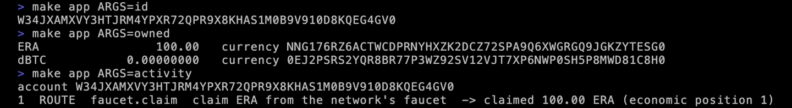

# Your app's own DSM account

Your app gets a DSM account. Not an API key, not a merchant id: an account like a wallet's, with its own identity, running the same code a phone runs.

<div class="flow"><span>your web app</span><i>→</i><span>loopback ingress<br>+ per-launch secret</span><i>→</i><span class="here">dsm-app-host<br>your account</span><i>→</i><span>storage nodes</span></div>

Your web app stays what it is: Node, Python, whatever it is today. Beside it runs one process, the app host, and that process is your account. Your app talks to it over a local socket on the same machine, loopback only, with a secret the host writes for each launch. Wallets reach the host over TLS, through its relay.

## 1. Start it

```bash
make app-dev
```

This builds the TypeScript client, generates the Python client's types from `proto/dsm_app.proto`, builds the app host, and runs it with a data directory, a directory for the ingress secret, and the network's client config: the same five storage nodes the wallet ships with. The first build takes a while; later runs reuse it.

The first launch creates the account. It writes a recovery mnemonic once to the data directory, readable by you alone, and makes the account the way a phone does. The host waits until the network holds the account's directory entry, and only then opens its ingress. Then the account is funded from the network's faucet.

The last lines it prints:

```text
[app-dev] app account running
  storage set:    the beta network (hosted; …/dsm_client/frontend/public/dsm_env_config.toml)
  ingress:        http://127.0.0.1:8787   (your server calls this)
  ingress secret: …/.dsm-dev/app/ingress/ingress-token
  relay:          https://127.0.0.1:8443   (wallets reach this)
  recovery:       …/.dsm-dev/app/data/RECOVERY_MNEMONIC
  log:            …/.dsm-dev/app/host.log
funded: claimed 100.00 ERA (economic position 1)
```

`…` is the folder you cloned into. Line by line:

- **storage set**: the beta network, hosted, and the file that names it.
- **ingress**, on loopback port 8787: your server calls this.
- **ingress secret**: in its own directory, so your app can read the secret and nothing else of the account.
- **relay**, on port 8443: wallets reach this.
- **recovery**: the recovery mnemonic.
- **funded**: 100 ERA from the faucet.

> [!WARNING]
> Back up the recovery mnemonic like a wallet's, because that is what it is. Whoever can read the data directory controls the account.

`make app-dev` returns once the account is running; the host keeps running in the background. `make app-dev-down` stops it, and `make dev-down` stops it and the terminal wallets.

## 2. Look at it

The app's command line talks to the account through the same ingress your code will. `id` prints the account's identity:

```bash
make app ARGS=id
```

`owned` prints what it holds:

```bash
make app ARGS=owned
```

`activity` is the account's own record of every call made through the ingress:

```bash
make app ARGS=activity
```

<figure class="term"><a href="images/term-app-account.webp"></a><figcaption>A hundred ERA from the faucet, nothing of dBTC yet, and the faucet claim in the activity.</figcaption></figure>

Your app can read the activity too, from any point. That is how it learns what happened without trusting anyone's say-so.

## 3. The ingress

Three routes make the ingress:

| Route | What it does |
|---|---|
| `POST /ingress` | Makes a call, and records it in the account's activity. |
| `POST /ingress/quiet` | Makes a call that is not recorded: what your app polls with. |
| `GET /activity/{after}` | Reads what was recorded after that point. |

Every call carries the launch's secret as `Authorization: Bearer <secret>`, must name the ingress as its `Host`, and may come from no other web origin. A web page in a browser on the same machine can neither read the secret nor send it. The clients wrap all of this; you will not write these requests by hand.

## 4. The wire

On the wire, each call is one protobuf message, the route's name and its arguments, answered with one message back. The schema is one file, [`proto/dsm_app.proto`](https://github.com/deterministicstatemachine/dsm/blob/main/proto/dsm_app.proto), and the TypeScript and Python clients are generated from it. For a client in another language, that file is all you need: send an `IngressRequest` (a `RouterInvokeOp` or `RouterQueryOp`: the route's name and an `ArgPack` holding its request message) to `POST /ingress`, and an `IngressResponse` comes back. [`clients/typescript/src/ingress.ts`](https://github.com/deterministicstatemachine/dsm/blob/main/clients/typescript/src/ingress.ts) is the whole exchange, in one short file.

## 5. The first call

Here is the first call in TypeScript and in Python: open the local account, and ask for its connections.

```ts
import { localAccount } from "dsm-app-client";

const app = await localAccount("app");
console.log(await app.connections());
```

```python
from dsm_app_client import local_app

app = local_app()
print(app.connections())
```

Each prints an empty list. Nothing is connected yet. [Write it into your app](clients.md) shows how to install each client; to try the Python one now, from the repo:

```bash
python3 -m venv .venv && . .venv/bin/activate
pip install -e clients/python
python3 clients/python/examples/account_status.py
```

`account_status.py` prints your account at a glance: its identity, what it owns, every connected wallet, and the latest activity.

Next: [Make an offer, connect a wallet](connect.md).
