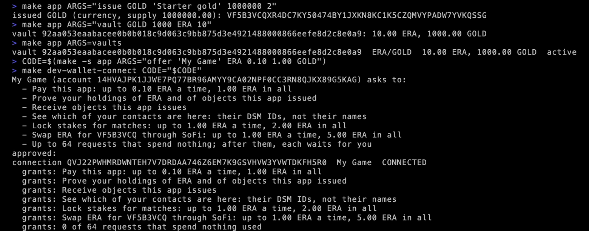
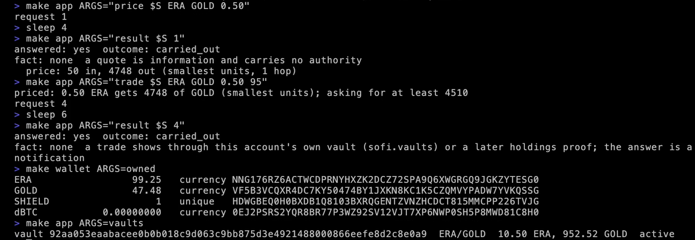
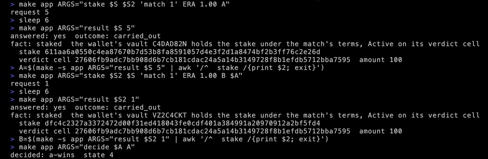
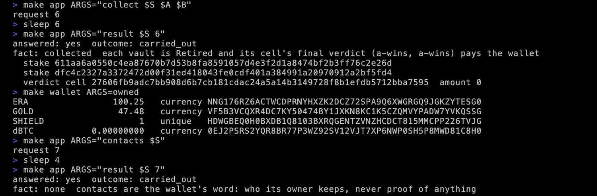

# Shops, matches and contacts

Three things your app can do beyond payments and sign-ins: run a shop of its own, where wallets buy your coin; referee matches, where two wallets stake and your key decides; and read a wallet's contacts.

This page carries on from the last two. Your app's account and the terminal wallet are running, and the wallet disconnected at the end of [Ask the wallet for things](requests.md).

## A shop of your own

<div class="flow"><span>your coin<br>reserve</span><i>→</i><span class="here">vault<br>your account's</span><i>→</i><span>ERA<br>reserve</span></div>

A shop is a vault your account opens between two objects, funded from what it holds: so much of your coin on one side, so much ERA on the other. Wallets trade against it through your account, and every trade moves the reserves. There is no order book, and no counterparty but the vault. The fee on each trade is yours to set; the command line's vaults charge 0.30%.

### 1. Issue a coin, open a vault

Your app issues GOLD, a coin with two decimal places and a million in supply. Your account holds all of it:

```bash
make app ARGS="issue GOLD 'Starter gold' 1000000 2"
```

Then it opens a vault: a thousand GOLD on one side, ten ERA on the other.

```bash
make app ARGS="vault GOLD 1000 ERA 10"
```

`vaults` lists it, with its id and its reserves:

```bash
make app ARGS=vaults
```

### 2. Connect with a trade grant

When `offer` names a coin after the caps, it also asks to trade: to sell the wallet that coin for ERA through your vault, up to 1.00 ERA a trade and 5.00 in all.

```bash
CODE=$(make -s app ARGS="offer 'My Game' ERA 0.10 1.00 GOLD")
```

```bash
make dev-wallet-connect CODE="$CODE"
```

<figure class="term"><a href="images/term-shop-and-offer.webp"></a><figcaption>The coin, the vault, and the offer the wallet approves. It names your coin by the start of its id.</figcaption></figure>

The new connection's id, in `$S` again:

```bash
S=$(make -s app ARGS=connections | awk -v w="$(make -s wallet ARGS=id)" '$4==w && $NF=="CONNECTED"{print $2}')
```

### 3. Price

`price` asks what half an ERA would get in GOLD through your vaults:

```bash
make app ARGS="price $S ERA GOLD 0.50"
```

```bash
make app ARGS="result $S 1"
```

```text
answered: yes  outcome: carried_out
fact: none  a quote is information and carries no authority
  price: 50 in, 4748 out (smallest units, 1 hop)
```

Half an ERA would get 47.48 GOLD. A price is information, never a fact: it can move before the trade.

### 4. Trade

```bash
make app ARGS="trade $S ERA GOLD 0.50 95"
```

`trade` makes three requests in a row, and prints each step. The wallet accepts GOLD first, because a wallet receives only what it has taken up itself. Then your account prices the trade. Then it asks the wallet to trade half an ERA for no less than 95% of that price:

```text
priced: 0.50 ERA gets 4748 of GOLD (smallest units); asking for at least 4510
request 4
```

```bash
make app ARGS="result $S 4"
```

```text
answered: yes  outcome: carried_out
fact: none  a trade shows through this account's own vault (sofi.vaults) or a later holdings proof; the answer is a notification
```

The wallet's answer is a notification. The evidence of a trade is in your own vault, and in what the wallet owns:

```bash
make wallet ARGS=owned
```

```bash
make app ARGS=vaults
```

<figure class="term"><a href="images/term-price-and-trade.webp"></a><figcaption>The wallet bought 47.48 GOLD, and the vault's reserves moved: a little more ERA, a little less GOLD.</figcaption></figure>

## A match your app referees

<div class="flow"><span>side A<br>stakes</span><i>→</i><span class="here">your key<br>decides A, B or void</span><i>→</i><span>side B<br>stakes against A</span></div>

A match is two stakes that share one verdict. Side A stakes; side B stakes against side A's stake, so the two are tied. Your account's key decides: A, B, or void. The winner's wallet collects. Each wallet builds its stake's terms itself, from the match you describe: your request names no branch, no signer and no recipient, so your app cannot send the money anywhere but where the rules say.

### 5. A second player

A match needs two wallets. Start a second one and connect it:

```bash
make dev-wallet2
```

```bash
CODE2=$(make -s app ARGS="offer 'My Game' ERA 0.10 1.00 GOLD")
```

```bash
make wallet2 ARGS="connect $CODE2"
```

```bash
S2=$(make -s app ARGS=connections | awk -v w="$(make -s wallet2 ARGS=id)" '$4==w && $NF=="CONNECTED"{print $2}')
```

### 6. Both stake

Side A stakes one ERA on "match 1", against the second wallet:

```bash
make app ARGS="stake $S $S2 'match 1' ERA 1.00 A"
```

On the first wallet's connection this is request 5: the price and the trade's three came first.

```bash
make app ARGS="result $S 5"
```

The fact is `staked`, and the result prints the stake's id. Keep it:

```bash
A=$(make -s app ARGS="result $S 5" | awk '/^  stake /{print $2; exit}')
```

Side B stakes the same, passing side A's stake as the one it stakes against, so both share the verdict:

```bash
make app ARGS="stake $S2 $S 'match 1' ERA 1.00 B $A"
```

```bash
make app ARGS="result $S2 1"
```

```bash
B=$(make -s app ARGS="result $S2 1" | awk '/^  stake /{print $2; exit}')
```

Each wallet's cap, one ERA a match and two in all, is what its player agreed to.

### 7. Decide and collect

Your app decides for A:

```bash
make app ARGS="decide $A A"
```

<figure class="term"><a href="images/term-match-stakes.webp"></a><figcaption>Two stakes, one verdict cell, and the decision.</figcaption></figure>

Then it asks side A's wallet to collect both stakes:

```bash
make app ARGS="collect $S $A $B"
```

```bash
make app ARGS="result $S 6"
```

```text
answered: yes  outcome: carried_out
fact: collected  each vault is Retired and its cell's final verdict (a-wins, a-wins) pays the wallet
```

```bash
make wallet ARGS=owned
```

The winner's wallet owns 100.25 ERA: its own stake back, and the other's. Each stake sat in a vault of its own wallet, under the match's terms. The match cost your account nothing, and your key only chose the branch.

## Contacts

`contacts` asks the wallet who its contacts are. The player granted it when connecting, and your app gets their DSM identities and nothing more: no names, no numbers, no photos.

```bash
make app ARGS="contacts $S"
```

```bash
make app ARGS="result $S 7"
```

```text
answered: yes  outcome: carried_out
fact: none  contacts are the wallet's word: who its owner keeps, never proof of anything
```

<figure class="term"><a href="images/term-match-collect-contacts.webp"></a><figcaption>The collection, the winner's 100.25 ERA, and contacts.</figcaption></figure>

## Duels

A duel is a match that a program decides instead of your key, from both players' signed moves, with no referee. The client's `ask.duel` helpers carry the setup, the readies, the signed moves and the settlement; the setup and the moves are built with the program's own library (for the program in this repo, [`crates/wildstate-duel-wasm`](https://github.com/deterministicstatemachine/dsm/tree/main/crates/wildstate-duel-wasm)). This guide does not walk through one.

Next: [Run your app's account in production](production.md).
