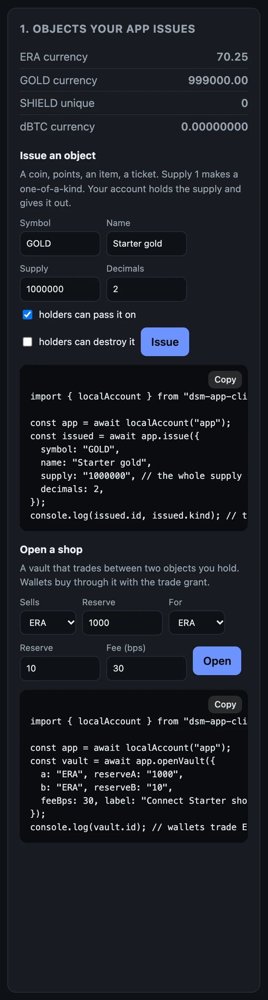

# Shops, matches and contacts

Three things your app can do beyond payments and sign-ins: run a shop of its own, where wallets buy your coin; referee matches, where two wallets stake and your key decides; and read a wallet's contacts.

This page carries on from the last ones. Your app's account and the terminal wallet are running, and the wallet disconnected at the end of [Ask the wallet for things](requests.md). The output below is from one run on the beta network.

## A shop of your own

<div class="flow"><span>your coin<br>reserve</span><i>→</i><span class="here">vault<br>your account's</span><i>→</i><span>ERA<br>reserve</span></div>

A shop is a vault your account opens between two objects, funded from what it holds: so much of your coin on one side, so much ERA on the other. Wallets trade against it through your account, and every trade moves the reserves. There is no order book, and no counterparty but the vault. The fee on each trade is yours to set; the command line's vaults charge 0.30%.

On the starter's page, issuing a coin and opening a shop are the first pieces, each with its code:

<div class="shots">
<figure style="flex-basis:330px;max-width:330px"><a href="images/starter-objects.webp"></a><figcaption>What your account owns, <b>Issue</b> and <b>Open</b>, and the code under each.</figcaption></figure>
</div>

### 1. Issue a coin, open a vault

Your app issues GOLD, a coin with two decimal places and a million in supply. Your account holds all of it:

```bash
dsm-app issue GOLD 'Starter gold' 1000000 2
```

```text
issued GOLD (currency, supply 1000000.00): 89S6HVVW03FRJZBNTR8M62ACZ56J0A09QJQ0ZCFDA3EHRB5KER1G
```

Then it opens a vault: a thousand GOLD on one side, ten ERA on the other.

```bash
dsm-app vault GOLD 1000 ERA 10
```

```text
vault 41ab586aaf3258f93bda09966b67eaa235dc0df3aa131eb56ffb2529a7e52eee: 1000.00 GOLD, 10.00 ERA
```

`vaults` lists it, with its id and its reserves:

```bash
dsm-app vaults
```

```text
vault 41ab586aaf3258f93bda09966b67eaa235dc0df3aa131eb56ffb2529a7e52eee  GOLD/ERA  1000.00 GOLD, 10.00 ERA  active
```

### 2. Connect with a trade grant

When `offer` names a coin after the caps, it also asks to trade: to sell the wallet that coin for ERA through your vault, up to 1.00 ERA a trade and 5.00 in all.

```bash
CODE=$(dsm-app offer 'My Game' ERA 0.10 1.00 GOLD)
```

```bash
dsm-dev-wallet connect "$CODE"
```

```text
My Game (account 0RHS9YDRSPR9PG9WESBX7PMGAVMEJSSVSC11QSD4NG4JPKY3XQ80) asks to:
  - Send this app: up to 0.10 ERA a time, 1.00 ERA in all
  - Prove what you own of ERA and of objects this app issued
  - Receive objects this app issues
  - See which of your contacts are here: their DSM IDs, not their names
  - Lock stakes for matches: up to 1.00 ERA a time, 2.00 ERA in all
  - Trade between ERA and 89S6HVVW: up to 1.00 ERA a time, 5.00 ERA in all
  - Up to 64 requests that spend nothing; after them, each waits for you
approved:
connection 97MSN2P9S07FVAFFBPNGW2GRPBAJQM3113MJG03V60MTAP4HBWW0  My Game  CONNECTED
  grants: Send this app: up to 0.10 ERA a time, 1.00 ERA in all
  grants: Prove what you own of ERA and of objects this app issued
  grants: Receive objects this app issues
  grants: See which of your contacts are here: their DSM IDs, not their names
  grants: Lock stakes for matches: up to 1.00 ERA a time, 2.00 ERA in all
  grants: Trade between ERA and 89S6HVVW: up to 1.00 ERA a time, 5.00 ERA in all
  grants: 0 of 64 requests that spend nothing used
```

The wallet names your coin by the start of its id, `89S6HVVW`. The new connection's id goes in `$S` again:

```bash
S=$(dsm-app connections | awk -v w="$(dsm-dev-wallet id)" '$4==w && $NF=="CONNECTED"{print $2}')
```

### 3. Price

`price` asks what half an ERA would get in GOLD through your vaults:

```bash
dsm-app price $S ERA GOLD 0.50
```

```text
request 1
```

```bash
dsm-app result $S 1
```

```text
answered: yes  outcome: carried_out
fact: none  a price is information and carries no authority
  price: 50 in, 4748 out (smallest units, 1 hop)
```

Half an ERA would get 47.48 GOLD. A price is information, never a fact: it can move before the trade.

### 4. Trade

```bash
dsm-app trade $S ERA GOLD 0.50 95
```

`trade` makes three requests in a row, and prints each step. The wallet accepts GOLD first, because a wallet receives only what it has taken up itself. Then your account prices the trade. Then it asks the wallet to trade half an ERA for no less than 95% of that price:

```text
priced: 0.50 ERA gets 4748 of GOLD (smallest units); asking for at least 4510
request 4
```

About ten seconds later:

```bash
dsm-app result $S 4
```

```text
answered: yes  outcome: carried_out
fact: none  a trade shows through this account's own vault (sofi.vaults) or a later proof of what it owns; the answer is a notification
```

The wallet's answer is a notification. The evidence of a trade is in your own vault, and in what the wallet owns:

```bash
dsm-dev-wallet owned
```

```text
ERA                 99.25   currency NNG176RZ6ACTWCDPRNYHXZK2DCZ72SPA9Q6XWGRGQ9JGKZYTESG0
GOLD                47.48   currency 89S6HVVW03FRJZBNTR8M62ACZ56J0A09QJQ0ZCFDA3EHRB5KER1G
SHIELD                  1   unique   C46M962T804B5XND8P2ASG4QK2VCB7SCGE5RNWRA4ST4112EK400
dBTC           0.00000000   currency 0EJ2PSRS2YQR8BR77P3WZ92SV12VJT7XP6NWP0SH5P8MWD81C8H0
```

```bash
dsm-app vaults
```

```text
vault 41ab586aaf3258f93bda09966b67eaa235dc0df3aa131eb56ffb2529a7e52eee  GOLD/ERA  952.52 GOLD, 10.50 ERA  active
```

The wallet bought 47.48 GOLD for 0.50 ERA, and the vault's reserves moved: a little more ERA, a little less GOLD.

## A match your app referees

<div class="flow"><span>side A<br>stakes</span><i>→</i><span class="here">your key<br>decides A, B or void</span><i>→</i><span>side B<br>stakes against A</span></div>

A match is two stakes that share one verdict. Side A stakes; side B stakes against side A's stake, so the two are tied. Your account's key decides: A, B, or void. The winner's wallet collects. Each wallet builds its stake's terms itself, from the match you describe: your request names no branch, no signer and no recipient, so your app cannot send the money anywhere but where the rules say.

### 5. A second player

A match needs two wallets. Start a second one, funded from the faucet like the first, and connect it:

```bash
DSM_WALLET_NAME=wallet2 dsm-dev-wallet up
```

```bash
CODE2=$(dsm-app offer 'My Game' ERA 0.10 1.00 GOLD)
```

```bash
DSM_WALLET_NAME=wallet2 dsm-dev-wallet connect $CODE2
```

It prints the same list as the first wallet, and its own connection. Its id goes in `$S2`:

```bash
S2=$(dsm-app connections | awk -v w="$(DSM_WALLET_NAME=wallet2 dsm-dev-wallet id)" '$4==w && $NF=="CONNECTED"{print $2}')
```

### 6. Both stake

Side A stakes one ERA on "match 1", against the second wallet:

```bash
dsm-app stake $S $S2 'match 1' ERA 1.00 A
```

```text
request 5
```

On the first wallet's connection this is request 5: the price and the trade's three came first.

```bash
dsm-app result $S 5
```

```text
answered: yes  outcome: carried_out
fact: staked  the wallet's vault MEJC8VVA holds the stake under the match's terms, Active on its verdict cell
  stake a3a4c46f6a3bc93ea5a37fde3ace814ac482a4eb33da21ce420defa953680930
  verdict cell 4348b438633afdcbdeddb108e1b2be177d35e1886189863f9e939e6d42130970  amount 100
```

The fact is `staked`, and the result prints the stake's id. Keep it:

```bash
A=$(dsm-app result $S 5 | awk '/^  stake /{print $2; exit}')
```

Side B stakes the same, passing side A's stake as the one it stakes against, so both share the verdict:

```bash
dsm-app stake $S2 $S 'match 1' ERA 1.00 B $A
```

```text
request 1
```

```bash
dsm-app result $S2 1
```

```text
answered: yes  outcome: carried_out
fact: staked  the wallet's vault JR65R02N holds the stake under the match's terms, Active on its verdict cell
  stake 960c5c0055233b430a8e5a92a8a0244c022ecd2b3b36f0755b6d592c05dc28c5
  verdict cell 4348b438633afdcbdeddb108e1b2be177d35e1886189863f9e939e6d42130970  amount 100
```

The two stakes name the same verdict cell. Keep the second id too:

```bash
B=$(dsm-app result $S2 1 | awk '/^  stake /{print $2; exit}')
```

Each wallet's cap, one ERA a match and two in all, is what its player agreed to.

### 7. Decide and collect

Your app decides for A:

```bash
dsm-app decide $A A
```

```text
decided: a-wins  state 4
```

Then it asks side A's wallet to collect both stakes:

```bash
dsm-app collect $S $A $B
```

```text
request 6
```

Until the wallet has collected, the result says so:

```text
answered: no  outcome: unanswered
fact: none  vault MEJC8VVA is not released yet; an answer saying collected grants nothing
```

About fifteen seconds later:

```bash
dsm-app result $S 6
```

```text
answered: yes  outcome: carried_out
fact: collected  each vault is Retired and its cell's final verdict (a-wins, a-wins) pays the wallet
  stake a3a4c46f6a3bc93ea5a37fde3ace814ac482a4eb33da21ce420defa953680930
  stake 960c5c0055233b430a8e5a92a8a0244c022ecd2b3b36f0755b6d592c05dc28c5
  verdict cell 4348b438633afdcbdeddb108e1b2be177d35e1886189863f9e939e6d42130970  amount 0
```

```bash
dsm-dev-wallet owned
```

```text
ERA                100.25   currency NNG176RZ6ACTWCDPRNYHXZK2DCZ72SPA9Q6XWGRGQ9JGKZYTESG0
GOLD                47.48   currency 89S6HVVW03FRJZBNTR8M62ACZ56J0A09QJQ0ZCFDA3EHRB5KER1G
SHIELD                  1   unique   C46M962T804B5XND8P2ASG4QK2VCB7SCGE5RNWRA4ST4112EK400
dBTC           0.00000000   currency 0EJ2PSRS2YQR8BR77P3WZ92SV12VJT7XP6NWP0SH5P8MWD81C8H0
```

The winner's wallet owns 100.25 ERA: its own stake back, and the other's. Each stake sat in a vault of its own wallet, under the match's terms. The match cost your account nothing, and your key only chose the branch.

## Contacts

`contacts` asks the wallet who its contacts are. The player granted it when connecting, and your app gets their DSM identities and nothing more: no names, no numbers, no photos.

```bash
dsm-app contacts $S
```

```text
request 7
```

```bash
dsm-app result $S 7
```

```text
answered: yes  outcome: carried_out
fact: none  contacts are the wallet's word: who its owner keeps, never proof of anything
```

## Duels

A duel is a match that a program decides instead of your key, from both players' signed moves, with no referee. The client's `ask.duel` helpers carry the setup, the readies, the signed moves and the settlement; the setup and the moves are built with the program's own library (for the program in this repo, [`crates/wildstate-duel-wasm`](https://github.com/deterministicstatemachine/dsm/tree/main/crates/wildstate-duel-wasm)). This guide does not walk through one.

## The whole page, as one script

With `dsm-app up` running and the terminal wallet disconnected, this runs every step above, waiting for each request to settle before reading it. Each run opens another vault from your account's ERA.

```bash
dsm-app issue GOLD 'Starter gold' 1000000 2
dsm-app vault GOLD 1000 ERA 10
dsm-app vaults
CODE=$(dsm-app offer 'My Game' ERA 0.10 1.00 GOLD)
dsm-dev-wallet connect "$CODE"
S=$(dsm-app connections | awk -v w="$(dsm-dev-wallet id)" '$4==w && $NF=="CONNECTED"{print $2}')
dsm-app price $S ERA GOLD 0.50
until dsm-app result $S 1 | grep -q "^answered: yes"; do sleep 3; done
dsm-app result $S 1
dsm-app trade $S ERA GOLD 0.50 95
until dsm-app result $S 4 | grep -q "^answered: yes"; do sleep 3; done
dsm-app result $S 4
dsm-dev-wallet owned
dsm-app vaults
DSM_WALLET_NAME=wallet2 dsm-dev-wallet up
CODE2=$(dsm-app offer 'My Game' ERA 0.10 1.00 GOLD)
DSM_WALLET_NAME=wallet2 dsm-dev-wallet connect $CODE2
S2=$(dsm-app connections | awk -v w="$(DSM_WALLET_NAME=wallet2 dsm-dev-wallet id)" '$4==w && $NF=="CONNECTED"{print $2}')
dsm-app stake $S $S2 'match 1' ERA 1.00 A
until dsm-app result $S 5 | grep -q "^fact: staked"; do sleep 3; done
dsm-app result $S 5
A=$(dsm-app result $S 5 | awk '/^  stake /{print $2; exit}')
dsm-app stake $S2 $S 'match 1' ERA 1.00 B $A
until dsm-app result $S2 1 | grep -q "^fact: staked"; do sleep 3; done
dsm-app result $S2 1
B=$(dsm-app result $S2 1 | awk '/^  stake /{print $2; exit}')
dsm-app decide $A A
dsm-app collect $S $A $B
until dsm-app result $S 6 | grep -q "^fact: collected"; do sleep 3; done
dsm-app result $S 6
dsm-dev-wallet owned
dsm-app contacts $S
until dsm-app result $S 7 | grep -q "^answered: yes"; do sleep 3; done
dsm-app result $S 7
```

Next: [Run your app's account in production](production.md).
