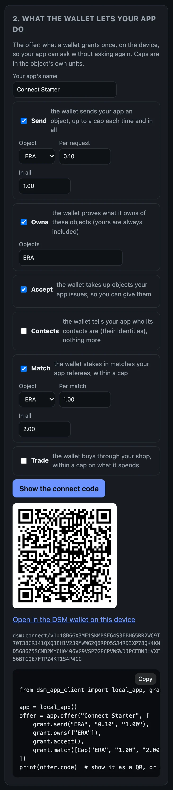
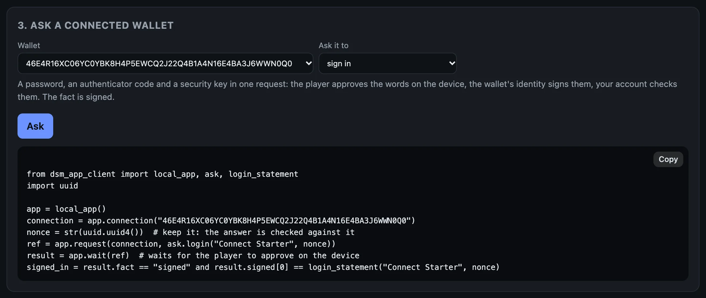

# Write it into your app

Everything the command line did, your app does with a client: JavaScript or TypeScript on Node.js 20 or later, or Python 3.10 or later. Both are generated from the same schema and use the same words: `offer`, `connections`, `request`, `result`, `wait`; `issue`, `give`; `owned`, `owns`. Requests are built with `ask.*`, and what an offer asks for with `grant.*`.

Your app needs a server side, even a small one, because the account's secret must never reach a browser page. The [starter](https://github.com/deterministicstatemachine/dsm/tree/main/examples/connect-starter) is one server file, and a page.

This page has the whole of an app, twice: the same program in JavaScript and in Python. Each makes an offer, waits for a wallet to connect to it, takes a payment, gives the player 100 gems of its own coin, and signs the player in. Copy either one whole. Both ran, as written, against an account on the beta network, and their output is below them.

## The whole program, in JavaScript

One file, [`my-game.mjs`](https://github.com/deterministicstatemachine/dsm/blob/main/guide/examples/my-game/my-game.mjs). Save it in your app's folder, where the TypeScript client is installed ([the account page](account.md#5-the-first-call)):

```js
{{#include ../examples/my-game/my-game.mjs}}
```

It is plain JavaScript, so `node` runs it with no build step, and it is valid TypeScript too. With `dsm-app up` running:

```bash
node my-game.mjs
```

(From the repo, it is in `guide/examples/my-game`, whose `package.json` depends on the client in the clone: `npm install`, then the same `node my-game.mjs`.)

It prints a connect code and waits. In a second terminal, connect a wallet to it: `dsm-dev-wallet connect ` followed by the code, or scan it on a phone. (A wallet connects to an app once: if the terminal wallet is still connected from the earlier pages, `dsm-dev-wallet disconnect $S` first, or connect a second one with `DSM_WALLET_NAME=wallet2 dsm-dev-wallet up`, then `DSM_WALLET_NAME=wallet2 dsm-dev-wallet connect <the code>`.) When the program asks for the sign-in, approve it as on the last page: `dsm-dev-wallet pending` shows the connection and the request's number, and `dsm-dev-wallet approve <connection> <number>` approves it.

What it printed:

```text
connect code: dsm:connect/v1:18B6GX3ME1SKMBSF64S3EBHG5RR2WC9T70T38CRJ41QXQJEH1V239MWMG2Q6RPQ5SJ4RD3XP78QK4KMD5G86Z5SCMB2MY6H0B03M69RKFDWBCDNTWZR7KEK2HJ0Y9JYVD945TPAJW7719A4HNYWG
waiting for a wallet to connect to it...
wallet EKJMVVEGD8KFQNP2DP8XJ0QFNSZTV5V7MHZKQZ0N7097WPG8ZPV0 connected
payment: outcome carried_out, fact received
gave 100 GEMS
sign-in asked: approve it on the device
sign-in: outcome carried_out, fact signed
signed: Sign in to My Game (a45c78b0-3774-466d-aee8-98cbdf2b9b49)
```

The wallet then owned the 100 GEMS:

```text
ERA                 98.95   currency NNG176RZ6ACTWCDPRNYHXZK2DCZ72SPA9Q6XWGRGQ9JGKZYTESG0
GEMS                  100   currency 4K53KPP5HCKG2NK0CRM8H888R3YYT7ACQ00BB7S6C5VVEQFNR670
dBTC           0.00000000   currency 0EJ2PSRS2YQR8BR77P3WZ92SV12VJT7XP6NWP0SH5P8MWD81C8H0
```

## The same program, in Python

[`my_game.py`](https://github.com/deterministicstatemachine/dsm/blob/main/guide/examples/my_game.py). Save it in your app's folder too:

```python
{{#include ../examples/my_game.py}}
```

With the Python client in the virtual environment from [the account page](account.md#5-the-first-call):

```bash
. .venv/bin/activate
python3 my_game.py
```

Connect a wallet to the code it prints, and approve the sign-in, as above. What it printed:

```text
connect code: dsm:connect/v1:18B6GX3ME1SKMBSF64S3EBHG5RR2WC9T70T38CRJ41QXQJEH1V239MWMG2Q6RPQ5SJ4RD3XP78QK4KMD5G86Z5SCMB2MY6H0V8KS5P8628JH2QR3BJ8Y97KTTFCQPFZ9NYH3AQN6PQZZP8XKEANG
waiting for a wallet to connect to it...
wallet HA62NJZ06ZY8C79HKM39AGTC3CMX9348RJH30GZTHA00BCSP0KV0 connected
payment: outcome carried_out, fact received
gave 100 GEMS
sign-in asked: approve it on the device
sign-in: outcome carried_out, fact signed
signed: Sign in to My Game (ef80f587-b7e4-4041-9088-d2b554da1071)
```

This run came after the JavaScript one, on the same account: issuing GEMS a second time answered with the same coin, and the account gave from what it still held.

## Your account at a glance

The install put two more Python programs in `~/.local/share/dsm/examples`: [`first_payment.py`](https://github.com/deterministicstatemachine/dsm/blob/main/clients/python/examples/first_payment.py), a connect code and one payment received (the newcomer check, `make first-run`, runs it on a clean Ubuntu), and [`account_status.py`](https://github.com/deterministicstatemachine/dsm/blob/main/clients/python/examples/account_status.py):

```python
{{#include ../../clients/python/examples/account_status.py}}
```

```bash
python3 ~/.local/share/dsm/examples/account_status.py
```

On the account from these pages, it began:

```text
account 0RHS9YDRSPR9PG9WESBX7PMGAVMEJSSVSC11QSD4NG4JPKY3XQ80
  ERA                 60.60   currency
  GEMS               999800   currency
  GOLD            999000.00   currency
  SHIELD                  0   unique
  dBTC           0.00000000   currency
6 connection(s) with wallets
  connection 46E4R16XC06YC0YBK8H4P5EWCQ2J22Q4B1A4N16E4BA3J6WWN0Q0  wallet HA62NJZ06ZY8C79HKM39AGTC3CMX9348RJH30GZTHA00BCSP0KV0  disconnected
    may: Send this app: up to 0.10 ERA a time, 1.00 ERA in all
    may: Prove what you own of ERA and of objects this app issued
    may: Receive objects this app issues
    may: Lock stakes for matches: up to 1.00 ERA a time, 2.00 ERA in all
```

and went on with every other connection, and the latest activity.

## Every piece, in either language

On the starter's page, the switch at the top shows every piece's code in Python instead of TypeScript. Here are the offer and the sign-in:

<div class="shots">
<figure style="flex-basis:330px;max-width:330px"><a href="images/starter-offer-python.webp"></a><figcaption>The offer, in Python.</figcaption></figure>
</div>

<figure class="term"><a href="images/starter-ask-login-python.webp"></a><figcaption>The sign-in, in Python: the code keeps the nonce and checks the signed words against <code>login_statement</code>.</figcaption></figure>

## In your own app

**JavaScript or TypeScript.** `npm install` the client's package (`~/.local/share/dsm/clients/dsm-app-client-0.1.0-beta.4.tgz`) into your app, as [the account page](account.md#5-the-first-call) did; its types are inside it, so nothing is compiled. `localAccount("app")` finds the account `dsm-app up` runs by looking for the `.dsm-dev` folder above the folder you run in. From anywhere else, name it: `DSM_DEV_DIR=/path/to/your/app/.dsm-dev`. On a server of your own, open the account from the ingress's address and the secret file the host writes: `new AppAccount(await Ingress.fromSecretFile(url, secretFile))`.

**Python.** `pip install` the client's wheel (`~/.local/share/dsm/clients/dsm_app_client-0.1.0b4-py3-none-any.whl`) into your app's virtual environment. `local_app()` finds the account the same way, and `DSM_DEV_DIR` names it from anywhere else. On a server of your own: `AppAccount(Ingress.from_secret_file(url, secret_file))`.

From a clone of the repo, the clients are `clients/typescript` (depend on it by path) and `clients/python` (`pip install -e clients/python`); both carry their generated types, so neither needs protoc.

## Any other language

Generate types from [`proto/dsm_app.proto`](https://github.com/deterministicstatemachine/dsm/blob/main/proto/dsm_app.proto), and send an `IngressRequest` (a `RouterInvokeOp` or `RouterQueryOp`: the route's name and an `ArgPack` holding its request message) to `POST /ingress`. An `IngressResponse` comes back: either an error, or `0x03` followed by an `Envelope`. [`clients/typescript/src/ingress.ts`](https://github.com/deterministicstatemachine/dsm/blob/main/clients/typescript/src/ingress.ts) is the whole exchange, in one short file. The routes are in the [reference](reference.md#routes).

## Objects

Everything an account can hold is an **object**: ERA, a sword, a ticket, a coin you issued. A currency is an object counted in units; an item is an object of which exactly one exists. You name an object by its symbol (`"ERA"`, `"GEMS"`) or by its id, and amounts in its own units (`"0.10"`, `"100"`); your account converts them, in both directions, so no client carries the unit rule. `issue` makes a new object, and your account then holds its whole supply. Issued again with the same terms, it answers with the same object. `give` hands some to a wallet that has accepted it.

Next, when you want it: [Shops, matches and contacts](advanced.md).
