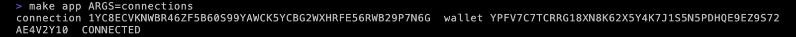

# Make an offer, connect a wallet

Your app shows a code, and a wallet connects to it. By the end of this page a wallet is connected to your account, and your app knows exactly what the wallet has let it do.

## What an offer is

An offer is what your app asks for, before a wallet agrees to anything. It carries your app's name and a list of **grants**: things the wallet will let your app do without asking the player again, each with a cap. Send, up to so much per request and so much in all. Owns, to prove what it holds. Accept, to take objects your app issues. The wallet shows all of it to the player before they approve. Nothing in a grant is hidden, and nothing outside it runs without the player.

In code, an offer is one call:

```ts
const offer = await app.offer({
  name: "My Game",
  grants: [grant.send("ERA", "0.10", "1.00"), grant.owns(["ERA"]), grant.accept()],
});
console.log(offer.code);
```

Amounts are in the object's own units: `"0.10"` is a tenth of an ERA. On this page you make the offer from the command line instead, and connect a wallet to it.

## 1. The starter (optional)

The starter is a web app plugged into DSM, and the place to build your app from pieces. It runs in the foreground, so give it a terminal of its own:

```bash
make starter
```

Open [http://127.0.0.1:3000](http://127.0.0.1:3000). The page is a builder, with three kinds of pieces, in the order an app uses them:

1. **Objects your app issues**: a coin, points, an item (supply 1 is a one-of-a-kind), a ticket; and a shop, a vault that sells one object for another.
2. **What the wallet lets your app do**: the offer. Tick the grants (send, owns, accept, contacts, match, trade), set each cap, and press **Show the connect code**.
3. **Ask a connected wallet**: send, prove what it owns, sign in, sign a statement, accept or receive an object, price or make a trade through your shop, stake on a match, decide it, collect.

Under every piece is the exact code it is, in TypeScript or Python, with a Copy button. The page never makes that code up: it asks the starter's server, which runs one mapping from piece to client call both to show the code and to make the call. Set the pieces up the way your app needs them, press the button to see it happen, then paste the code into your own app.

**Show the connect code** makes the offer: a code starting `dsm:connect/v1:`, and its QR. Every step below works with the starter's code as well as with the one the command line makes.

## 2. A wallet in the terminal

To test without a phone, start a player's wallet in the terminal:

```bash
make dev-wallet
```

It is a second account, made the same way `make app-dev` made yours, on the same network, and funded from the faucet. It prints the same lines as `make app-dev`, as `[app-dev] wallet account running`, with its ingress on port 8788 and its relay on 8444.

## 3. Make the offer

```bash
CODE=$(make -s app ARGS="offer 'My Game' ERA 0.10 1.00")
```

The words after `offer` are your app's name, the object a wallet may send it, the cap per request and the cap in all. The command line's offer asks for more than sends: to be shown what the wallet owns, to hand it objects your account issues, to see its contacts, and to referee matches it stakes ERA in (1.00 a match, 2.00 in all).

The code is now in `$CODE`:

```bash
echo $CODE
```

It is `dsm:connect/v1:` followed by about two hundred characters. It is long because it carries the relay's address and its certificate pin: the wallet fetches the offer itself, over TLS pinned to that certificate.

## 4. Connect the terminal wallet

```bash
make dev-wallet-connect CODE="$CODE"
```

The wallet fetches the offer, checks it, and prints what My Game asks for, one line per grant:

- Pay this app: up to 0.10 ERA a time, 1.00 ERA in all
- Prove your holdings of ERA and of objects this app issued
- Receive objects this app issues
- See which of your contacts are here: their DSM IDs, not their names
- Lock stakes for matches: up to 1.00 ERA a time, 2.00 ERA in all
- Up to 64 requests that spend nothing; after them, each waits for you

The terminal wallet is your test wallet, so it approves on its own, and prints the connection: its id, `My Game`, `CONNECTED`, and the grants it now holds. A player on a phone reads the same list and decides.

## 5. See it from your app's side

```bash
make app ARGS=connections
```

<figure class="term"><a href="images/term-connections.webp"></a><figcaption>One line per wallet: the connection's id, the wallet's identity, and CONNECTED.</figcaption></figure>

The connection's id is what every request on the next page names.

## 6. On a phone

On Android, the wallet's **Apps** screen has **Connect an app**. Scan the starter's QR with **Scan code**, or open the code as a link on the same phone and press **Read**. The wallet shows the same list the terminal printed: who asks, what for, and the caps. The player approves.

<div class="shots">
<figure><figcaption>A code, handed over as a link.</figcaption></figure>
<figure><figcaption>Who asks, and what for.</figcaption></figure>
<figure><figcaption>The player approves, or cancels.</figcaption></figure>
</div>

The iOS Simulator has no camera, so there the code opens as a link. This opens a code in the wallet on every phone on your machine at once, the adb devices and the booted iOS Simulators (debug builds of the wallet):

```bash
make phones-connect CODE="$CODE"
```

<div class="shots">
<figure><figcaption>The code, opened as a link.</figcaption></figure>
<figure><figcaption>The same list on iOS.</figcaption></figure>
<figure><figcaption>Approve.</figcaption></figure>
<figure><figcaption>Connected. The player can disconnect at any time.</figcaption></figure>
</div>

The red box says the code came from outside the wallet. Any app or web page on a phone can open such a link, so the wallet asks the player to approve only an offer they opened themselves, from the app they mean to connect.

These phones were recorded before the command line's `offer` asked to see contacts, so their lists are one line shorter than the one above.

## What each side holds now

- The wallet holds a grant it can read and end at any time.
- Your account holds a connection to the wallet.
- No keys moved, and nothing was taken on the relay's word.

A wallet connects to an app once. To connect it again, it disconnects first (the [next page](requests.md) ends with that), or a second wallet connects: `make dev-wallet2`, then `make wallet2 ARGS="connect $CODE"`.

Next: [Ask the wallet for things](requests.md).
