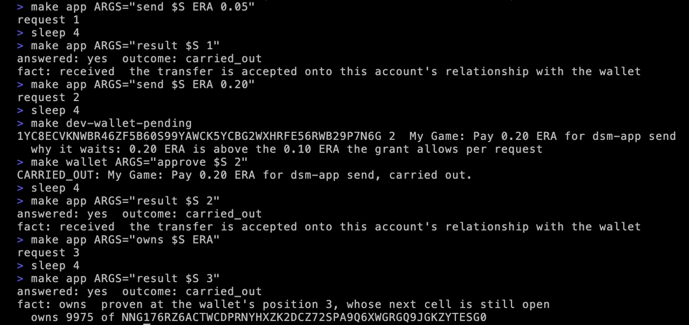
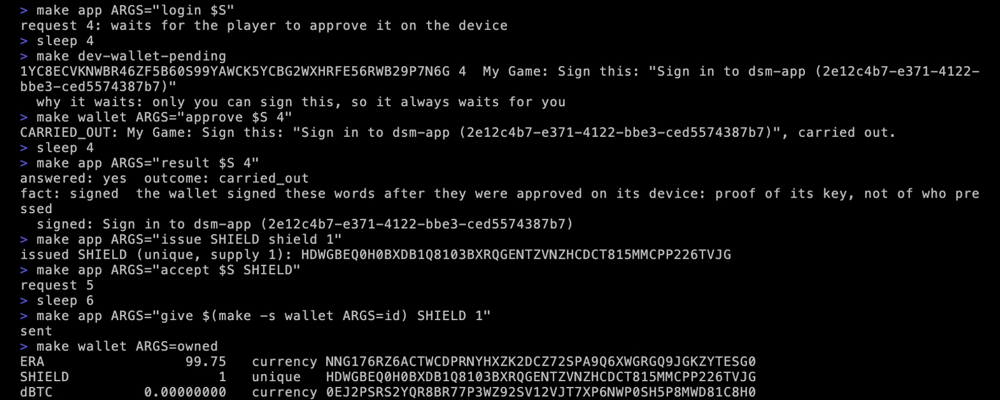

# Ask the wallet for things

Your app asks a connected wallet for things. Inside the grant, it just happens. Outside it, the player decides. In every case, your own account checks the result.

## Outcome and fact

Every request has two answers, and only one is evidence:

| | Where it comes from | Use it for |
|---|---|---|
| **outcome** | the wallet's word: `carried_out`, `awaiting_approval`, `declined`, `failed` | what to show the player while you wait |
| **fact** | what your own account established: `received`, `owns`, `signed`, `staked`, `collected` | deciding anything: delivering the item, logging the player in, crediting the sale |

`received` means your account has taken up a transfer the wallet sent. `owns` means a proof of the wallet's holdings verified. `signed` means a signature checked. Code against the fact: the outcome tells you what the wallet said, and the fact tells you what happened.

The commands below use the terminal wallet from the [last page](connect.md). Each request gets a number on its connection, and `result` reads what became of it. The wallet answers within moments, so give it a few seconds before you ask for the result.

## 1. Find the connection

```bash
S=$(make -s app ARGS=connections | awk -v w="$(make -s wallet ARGS=id)" '$4==w && $NF=="CONNECTED"{print $2}')
```

This puts the terminal wallet's connection id in `$S`: the line of `connections` whose wallet is your terminal wallet, and is connected.

## 2. A send inside the grant

Ask the wallet to send your account five hundredths of an ERA:

```bash
make app ARGS="send $S ERA 0.05"
```

It prints `request 1`. A moment later:

```bash
make app ARGS="result $S 1"
```

```text
answered: yes  outcome: carried_out
fact: received  the transfer is accepted onto this account's relationship with the wallet
```

No prompt on the phone: 0.05 is inside the cap the player approved.

## 3. A send over the cap

Now 0.20 ERA, twice the cap per request:

```bash
make app ARGS="send $S ERA 0.20"
```

The wallet does not carry it out. It waits for the player, and says why:

```bash
make dev-wallet-pending
```

The request shows with `why it waits: 0.20 ERA is above the 0.10 ERA the grant allows per request`. The player approves it, here in the terminal, or on the phone:

```bash
make wallet ARGS="approve $S 2"
```

```bash
make app ARGS="result $S 2"
```

The fact is `received` again: the same fact, one more step.

<div class="shots">
<figure><figcaption>Outside the grant: the player decides.</figcaption></figure>
<figure><figcaption>Approved and carried out.</figcaption></figure>
<figure><figcaption>The same on iOS.</figcaption></figure>
<figure><figcaption>Carried out.</figcaption></figure>
</div>

## 4. Prove what it owns

`owns` asks the wallet to prove what it holds of an object. The wallet builds a proof at its current position, and your account verifies it, not the wallet's say-so:

```bash
make app ARGS="owns $S ERA"
```

```bash
make app ARGS="result $S 3"
```

```text
answered: yes  outcome: carried_out
fact: owns  proven at the wallet's position 3, whose next cell is still open
```

The next line gives the amount, in the object's smallest units: `owns 9975` of ERA, which is 99.75 ERA after the two sends.

<figure class="term"><a href="images/term-requests-inside-and-over.webp"></a><figcaption>Steps 2 to 4 in one run. The recording pauses with <code>sleep</code> before each result.</figcaption></figure>

## 5. Sign in

`login` is a sign-in. Your app makes a nonce and asks the wallet to sign "Sign in to", your app's name, and the nonce. It always waits for the player, because only they can sign:

```bash
make app ARGS="login $S"
```

It prints `request 4: waits for the player to approve it on the device`. Pending shows the exact words to be signed:

```bash
make dev-wallet-pending
```

The player approves:

```bash
make wallet ARGS="approve $S 4"
```

```bash
make app ARGS="result $S 4"
```

```text
answered: yes  outcome: carried_out
fact: signed  the wallet signed these words after they were approved on its device: proof of its key, not of who pressed
  signed: Sign in to dsm-app (2e12c4b7-e371-4122-bbe3-ced5574387b7)
```

Your app compares the signed words with what it asked. That is a password, an authenticator code and a security key in one request, with nothing for you to store but the nonce.

<div class="shots">
<figure><figcaption>A sign-in from the starter, on Android.</figcaption></figure>
<figure><figcaption>And on iOS. Only the player can sign, so it always waits.</figcaption></figure>
</div>

## 6. Issue an object and give it

Your app issues an object: SHIELD, a one-of-a-kind item, supply 1. Your account holds it:

```bash
make app ARGS="issue SHIELD shield 1"
```

A wallet receives only what it has taken up itself, so your app asks it to accept the object:

```bash
make app ARGS="accept $S SHIELD"
```

Give it a few seconds, then give it the shield:

```bash
make app ARGS="give $(make -s wallet ARGS=id) SHIELD 1"
```

```bash
make wallet ARGS=owned
```

The wallet owns 99.75 ERA and one SHIELD. The item is the player's now. They can send it on in the wallet, and your app still sees who holds it with `owns`.

<figure class="term"><a href="images/term-requests-login-and-give.webp"></a><figcaption>Steps 5 and 6 in one run.</figcaption></figure>

## 7. Disconnect

```bash
make wallet ARGS="disconnect $S"
```

The grant ends, and the connection shows `DISCONNECTED` on your side. A wallet that wants to connect again does it with a new offer.

## What to keep from this page

- Log the facts, not the outcomes.
- Show players what you asked for and what they approved.
- Trust nothing the relay says. Your account already checked.

That is the whole developer path: a code, a connection, requests, facts.

Next: [Write it into your app](clients.md).
