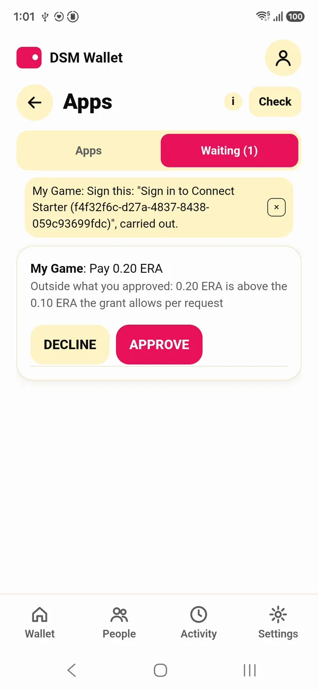
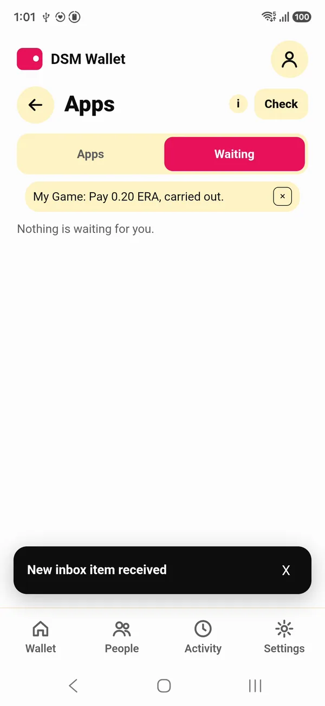
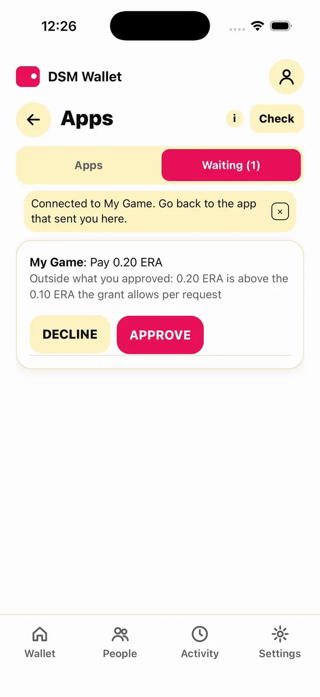
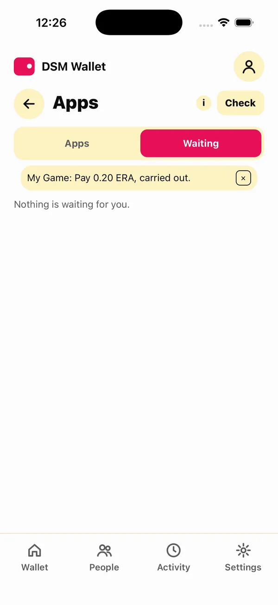
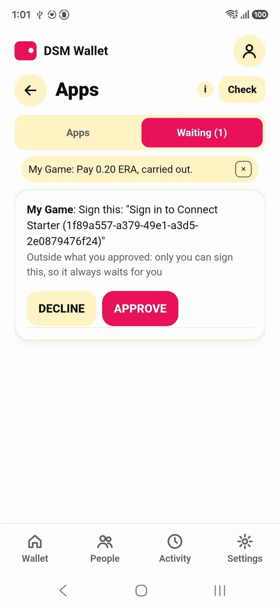
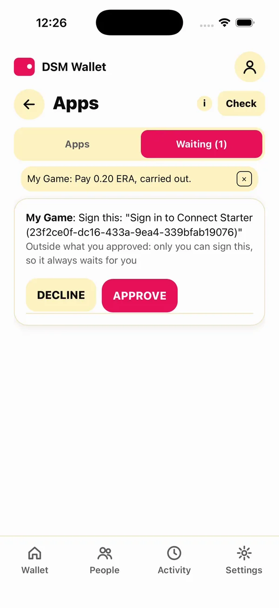
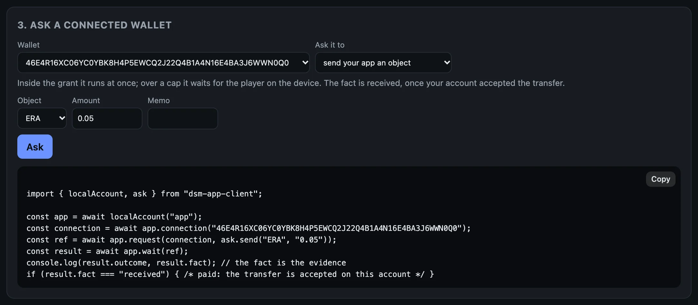
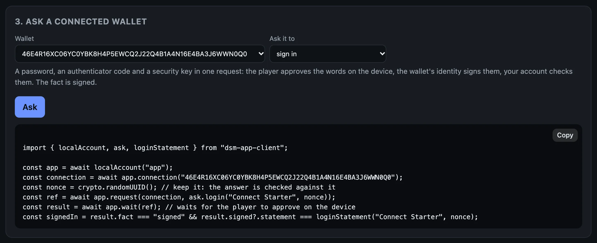
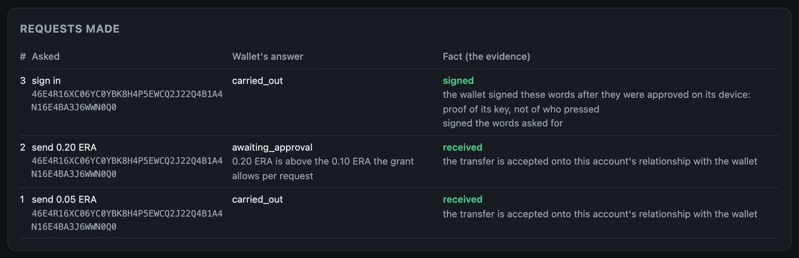
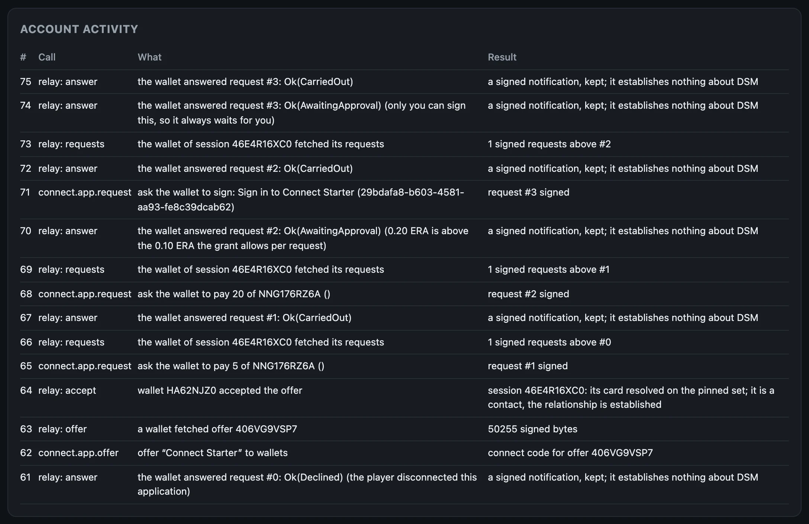

# Ask the wallet for things

Your app asks a connected wallet for things. Inside the grant, it just happens. Outside it, the player decides. In every case, your own account checks the result.

## Outcome and fact

Every request has two answers, and only one is evidence:

| | Where it comes from | Use it for |
|---|---|---|
| **outcome** | the wallet's word: `carried_out`, `awaiting_approval`, `declined`, `failed` | what to show the player while you wait |
| **fact** | what your own account established: `received`, `owns`, `signed`, `staked`, `collected` | deciding anything: delivering the item, logging the player in, crediting the sale |

`received` means your account has taken up a transfer the wallet sent. `owns` means a proof of what the wallet owns verified. `signed` means a signature checked. Code against the fact: the outcome tells you what the wallet said, and the fact tells you what happened.

The commands below use the terminal wallet from the [last page](connect.md). Each request gets a number on its connection, and `result` reads what became of it.

> [!NOTE]
> On the beta network a request takes from a few seconds to about half a minute to settle: the wallet and your account each write to the storage nodes over the internet. Until it settles, `result` says so:
>
> ```text
> answered: no  outcome: unanswered
> fact: none  no transfer this account accepted answers it yet; an answer saying sent grants nothing
> ```
>
> Run it again a little later. The wallet also answers a connection's requests in order, so a request that waits for the player holds up the ones after it.

## 1. Find the connection

```bash
S=$(dsm-app connections | awk -v w="$(dsm-dev-wallet id)" '$4==w && $NF=="CONNECTED"{print $2}')
```

This puts the terminal wallet's connection id in `$S`: the line of `connections` whose wallet is your terminal wallet, and is connected.

## 2. A send inside the grant

Ask the wallet to send your account five hundredths of an ERA:

```bash
dsm-app send $S ERA 0.05
```

```text
request 1
```

Once it settles:

```bash
dsm-app result $S 1
```

```text
answered: yes  outcome: carried_out
fact: received  the transfer is accepted onto this account's relationship with the wallet
```

No prompt on the phone: 0.05 is inside the cap the player approved.

## 3. A send over the cap

Now 0.20 ERA, twice the cap per request:

```bash
dsm-app send $S ERA 0.20
```

```text
request 2
```

The wallet does not carry it out. It waits for the player, and says why:

```bash
dsm-dev-wallet pending
```

```text
RKBQ40RXFBYWZCJ150X3XG32V7EQYPN1SDGV96VGGTCAQCJMCSTG 2  My Game: Send 0.20 ERA for dsm-app send
  why it waits: 0.20 ERA is above the 0.10 ERA the grant allows per request
```

If it says `nothing waiting`, the request has not reached the wallet yet: give it a moment. The player approves it, here in the terminal, or on the phone:

```bash
dsm-dev-wallet approve $S 2
```

```text
CARRIED_OUT: My Game: Send 0.20 ERA for dsm-app send, carried out.
```

Approving too early fails with `request 2 is not waiting`; list pending again first. About ten seconds later:

```bash
dsm-app result $S 2
```

```text
answered: yes  outcome: carried_out
fact: received  the transfer is accepted onto this account's relationship with the wallet
```

The same fact, one more step. On a phone, the request waits under **Waiting**, with the reason:

<div class="shots">
<figure><figcaption>Outside the grant: the player decides.</figcaption></figure>
<figure><figcaption>Approved and carried out.</figcaption></figure>
<figure><figcaption>The same on iOS.</figcaption></figure>
<figure><figcaption>Carried out.</figcaption></figure>
</div>

## 4. Prove what it owns

`owns` asks the wallet to prove what it holds of an object. The wallet builds a proof at its current position, and your account verifies it, not the wallet's say-so:

```bash
dsm-app owns $S ERA
```

```text
request 3
```

```bash
dsm-app result $S 3
```

```text
answered: yes  outcome: carried_out
fact: owns  proven at the wallet's position 3, whose next cell is still open
  owns 9975 of NNG176RZ6ACTWCDPRNYHXZK2DCZ72SPA9Q6XWGRGQ9JGKZYTESG0
```

The amount is in the object's smallest units, and the long id is ERA's: 9975 is 99.75 ERA after the two sends.

## 5. Sign in

`login` is a sign-in. Your app makes a nonce and asks the wallet to sign "Sign in to", your app's name, and the nonce. It always waits for the player, because only they can sign:

```bash
dsm-app login $S
```

```text
request 4: waits for the player to approve it on the device
```

Pending shows the exact words to be signed:

```bash
dsm-dev-wallet pending
```

```text
RKBQ40RXFBYWZCJ150X3XG32V7EQYPN1SDGV96VGGTCAQCJMCSTG 4  My Game: Sign this: "Sign in to dsm-app (3a6b4e28-b931-4116-b53a-b1681d5aa7b3)"
  why it waits: only you can sign this, so it always waits for you
```

The player approves:

```bash
dsm-dev-wallet approve $S 4
```

```text
CARRIED_OUT: My Game: Sign this: "Sign in to dsm-app (3a6b4e28-b931-4116-b53a-b1681d5aa7b3)", carried out.
```

```bash
dsm-app result $S 4
```

```text
answered: yes  outcome: carried_out
fact: signed  the wallet signed these words after they were approved on its device: proof of its key, not of who pressed
  signed: Sign in to dsm-app (3a6b4e28-b931-4116-b53a-b1681d5aa7b3)
```

Your app compares the signed words with what it asked. That is a password, an authenticator code and a security key in one request, with nothing for you to store but the nonce.

<div class="shots">
<figure><figcaption>A sign-in from the starter, on Android.</figcaption></figure>
<figure><figcaption>And on iOS. Only the player can sign, so it always waits.</figcaption></figure>
</div>

## 6. Issue an object and give it

Your app issues an object: SHIELD, a one-of-a-kind item, supply 1. Your account holds it:

```bash
dsm-app issue SHIELD shield 1
```

```text
issued SHIELD (unique, supply 1): C46M962T804B5XND8P2ASG4QK2VCB7SCGE5RNWRA4ST4112EK400
```

A wallet receives only what it has taken up itself, so your app asks it to accept the object:

```bash
dsm-app accept $S SHIELD
```

```text
request 5
```

Give it a few seconds, then give it the shield:

```bash
dsm-app give $(dsm-dev-wallet id) SHIELD 1
```

```text
sent
```

The transfer is final once sent; the wallet takes it up within seconds. Until then what it owns shows the shield at 0:

```bash
dsm-dev-wallet owned
```

```text
ERA                 99.75   currency NNG176RZ6ACTWCDPRNYHXZK2DCZ72SPA9Q6XWGRGQ9JGKZYTESG0
SHIELD                  1   unique   C46M962T804B5XND8P2ASG4QK2VCB7SCGE5RNWRA4ST4112EK400
dBTC           0.00000000   currency 0EJ2PSRS2YQR8BR77P3WZ92SV12VJT7XP6NWP0SH5P8MWD81C8H0
```

The item is the player's now. They can send it on in the wallet, and your app still sees who holds it with `owns`.

SHIELD's supply is 1, so it can be given once. Run this page again on the same account and `issue` answers with the same SHIELD, but `give` fails: the account no longer holds it (`balance underflow on debit (insufficient funds)`).

## 7. Disconnect

```bash
dsm-dev-wallet disconnect $S
```

```text
connection RKBQ40RXFBYWZCJ150X3XG32V7EQYPN1SDGV96VGGTCAQCJMCSTG  My Game  DISCONNECTED
  grants: Send this app: up to 0.10 ERA a time, 1.00 ERA in all
  grants: Prove what you own of ERA and of objects this app issued
  grants: Receive objects this app issues
  grants: See which of your contacts are here: their DSM IDs, not their names
  grants: Lock stakes for matches: up to 1.00 ERA a time, 2.00 ERA in all
  grants: 2 of 64 requests that spend nothing used
  used:   0.05 of 2.00 ERA
```

The grant ends, and the connection shows `DISCONNECTED` on your side too. `used` counts what went through the grant: the 0.05. The 0.20 the player approved by hand is not in it. A wallet that wants to connect again does it with a new offer.

## The same, on the starter's page

Everything above is a piece on the starter's page. Pick the wallet, pick what to ask, and the code under it is the call; **Ask** makes it:

<figure class="term"><a href="images/starter-ask-send.webp"></a><figcaption>Asking for 0.05 ERA. The code is the whole call, with the connection filled in.</figcaption></figure>

<figure class="term"><a href="images/starter-ask-login.webp"></a><figcaption>A sign-in: the code keeps the nonce and checks the signed words against it.</figcaption></figure>

The page keeps a table of what it asked. Here: a send inside the grant, one over it (the player approved it in the terminal), and a sign-in, each with the wallet's answer and the fact your account established:

<figure class="term"><a href="images/starter-requests.webp"></a><figcaption>The facts are the evidence: <code>received</code>, <code>received</code>, <code>signed</code>.</figcaption></figure>

And the account's activity, read from the ingress: every call your app made, and every time the wallet fetched its requests or answered one through the relay:

<figure class="term"><a href="images/starter-activity.webp"></a><figcaption>The relay's part is kept and labelled for what it is: a signed notification that establishes nothing.</figcaption></figure>

## What to keep from this page

- Log the facts, not the outcomes.
- Show players what you asked for and what they approved.
- Trust nothing the relay says. Your account already checked.

## The whole page, as one script

With the terminal wallet connected from the last page, this runs every step above, waiting for each request to settle before reading it, and approving as the player:

```bash
S=$(dsm-app connections | awk -v w="$(dsm-dev-wallet id)" '$4==w && $NF=="CONNECTED"{print $2}')
dsm-app send $S ERA 0.05
until dsm-app result $S 1 | grep -q "^fact: received"; do sleep 3; done
dsm-app result $S 1
dsm-app send $S ERA 0.20
until dsm-dev-wallet pending | grep -q "why it waits"; do sleep 3; done
dsm-dev-wallet pending
dsm-dev-wallet approve $S 2
until dsm-app result $S 2 | grep -q "^fact: received"; do sleep 3; done
dsm-app result $S 2
dsm-app owns $S ERA
until dsm-app result $S 3 | grep -q "^fact: owns"; do sleep 3; done
dsm-app result $S 3
dsm-app login $S
until dsm-dev-wallet pending | grep -q "Sign this"; do sleep 3; done
dsm-dev-wallet pending
dsm-dev-wallet approve $S 4
until dsm-app result $S 4 | grep -q "^fact: signed"; do sleep 3; done
dsm-app result $S 4
dsm-app issue SHIELD shield 1
dsm-app accept $S SHIELD
until dsm-app result $S 5 | grep -q "^answered: yes"; do sleep 3; done
dsm-app give $(dsm-dev-wallet id) SHIELD 1
until dsm-dev-wallet owned | grep -Eq "^SHIELD +1 "; do sleep 3; done
dsm-dev-wallet owned
dsm-dev-wallet disconnect $S
```

Next: [Write it into your app](clients.md).
