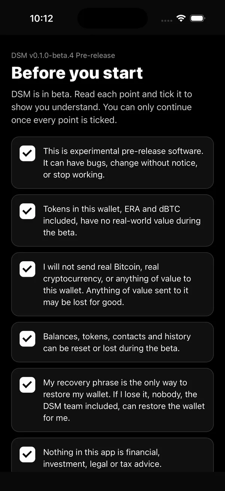
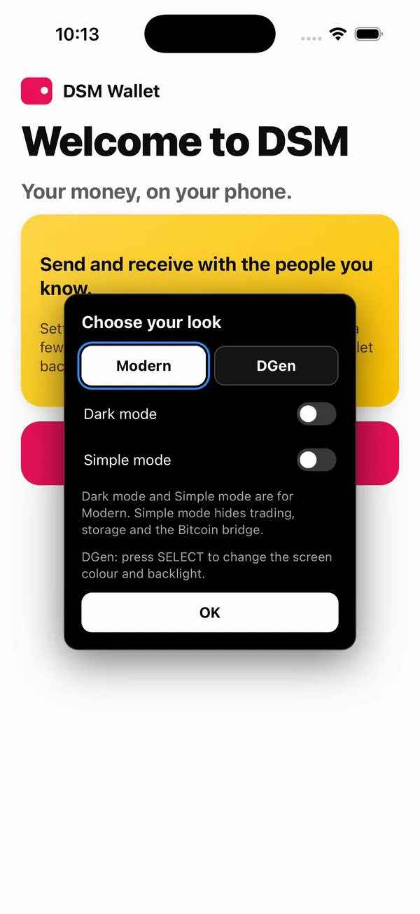
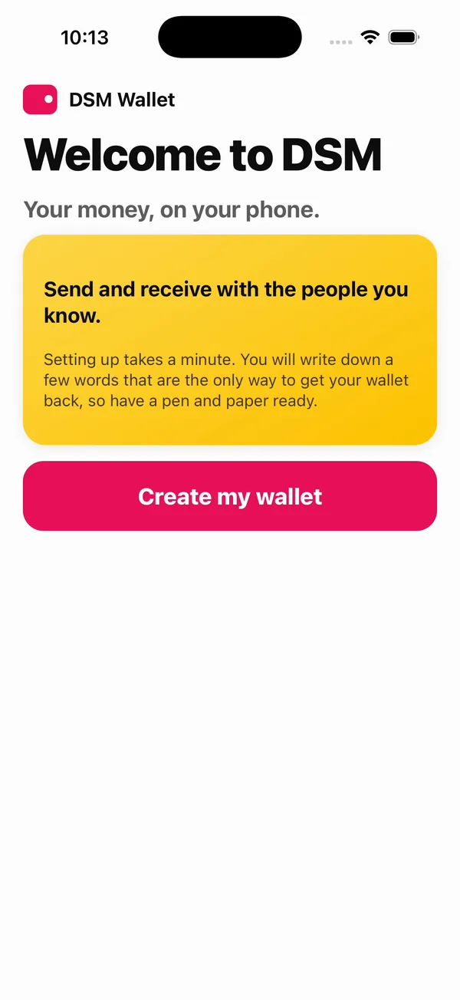
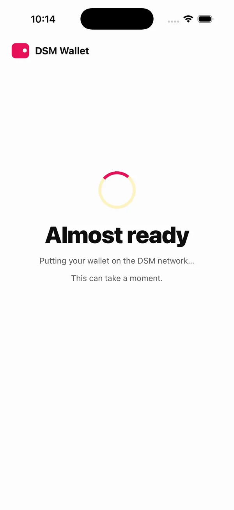
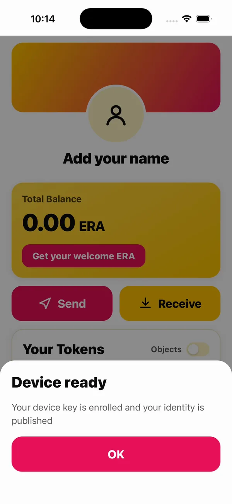
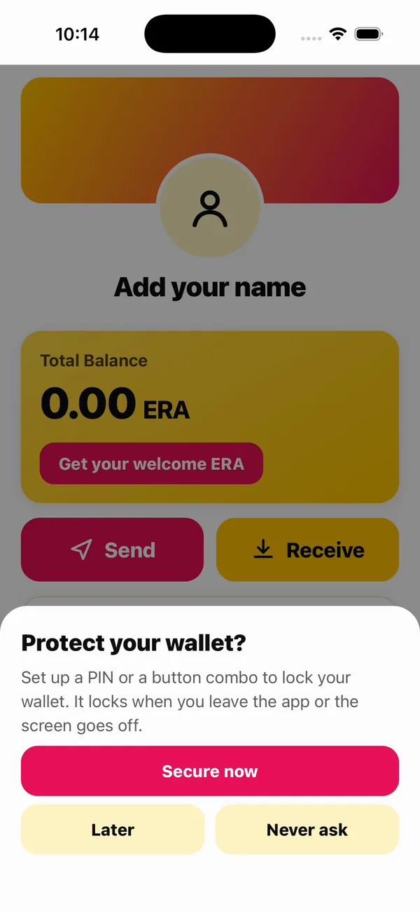
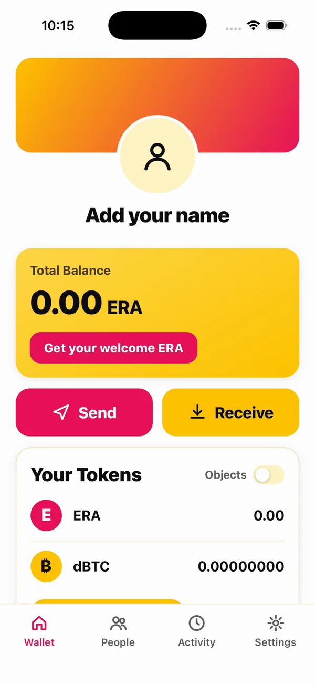
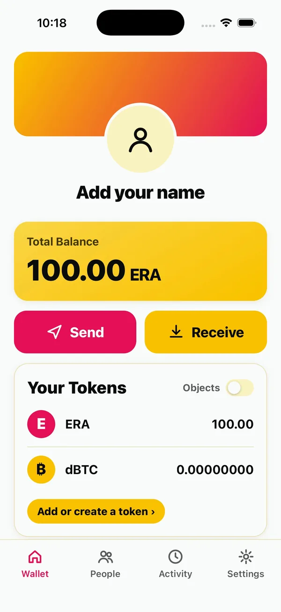
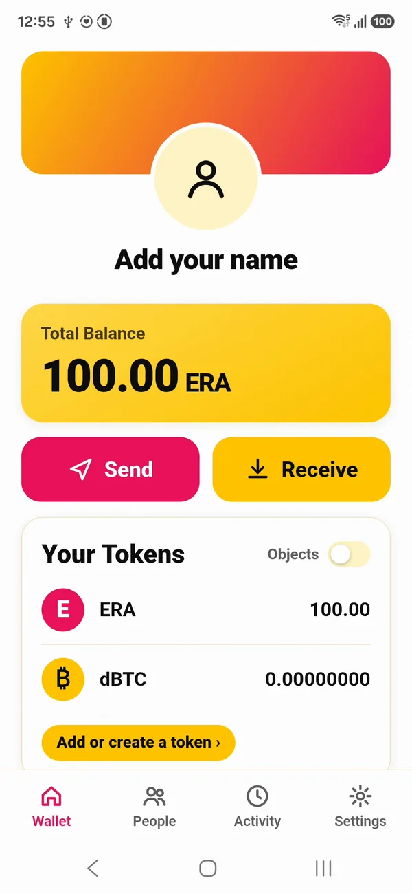

# The wallet on Android and iOS

This page is optional. Everything in this guide can be tested with a wallet in the terminal, which the [connect page](connect.md) starts with one command. Build the real wallet when you want to see what your players see.

As installed, the wallet is on the beta network: five storage nodes, named in a file inside the app with each one's certificate, so it trusts no node it was not built to trust. Your app's account will be on the same network.

## Android

You need Android Studio with the Android NDK `27.0.12077973`, and `ANDROID_NDK_HOME` set to it. With that in place, set the build up once:

```bash
make setup
```

Then build the wallet and install it on every phone connected over adb:

```bash
make install
```

`make android` builds the APK without installing it.

## iOS

On a Mac with Xcode, and `cbindgen`:

```bash
cargo install cbindgen
```

Build the Rust SDK for iOS, the wallet's screens, and the app for the Simulator, then install it on the Simulator that is running and open it:

```bash
make ios-libs
make ios-frontend
make ios-simulator
make ios-simulator-run
```

The iOS app runs the same Rust SDK and the same screens as the Android one.

For a real iPhone or iPad, run `make ios-device IOS_TEAM=` followed by your Apple team id: Xcode signs it with automatic provisioning. A free Apple ID gives a profile that lasts a week; a developer account, a year.

## The first run

The first run is the wallet's setup. You read the beta terms and tick each one, and you pick a look.

<div class="shots">
<figure><figcaption>The beta terms. You continue once every point is ticked.</figcaption></figure>
<figure><figcaption>Choose your look: Modern or DGen.</figcaption></figure>
<figure><figcaption>Create my wallet.</figcaption></figure>
</div>

Then the wallet makes its identity on your phone: a recovery phrase of 24 words, which you write down and check. The phrase is not shown here. After the check, the wallet puts itself on the network: it publishes its directory entry to the storage nodes, and then it is ready.

<div class="shots">
<figure><figcaption>Putting the wallet on the network.</figcaption></figure>
<figure><figcaption>Device ready.</figcaption></figure>
<figure><figcaption>A PIN or a button combo, now or later.</figcaption></figure>
</div>

Its first money is one tap: **Get your welcome ERA**, which the network's faucet gives a new account.

<div class="shots">
<figure><figcaption>A new wallet, at 0.00 ERA.</figcaption></figure>
<figure><figcaption>100.00 ERA, on iOS.</figcaption></figure>
<figure><figcaption>The same wallet on Android.</figcaption></figure>
</div>

Each wallet now holds ERA from the faucet, so there is something to pay your app with. Nothing of the network runs on your machine.

Next: [Your app's own DSM account](account.md).
